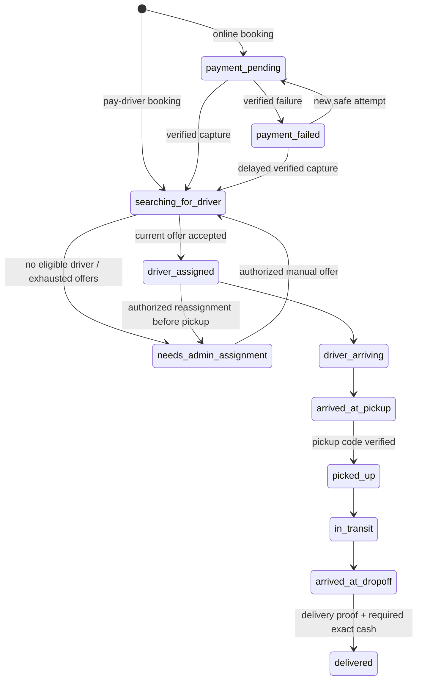

# Customer parcel delivery implementation

Date: 2026-10-22. Status: **implemented as a disabled, isolated-test workflow; not ready for production activation**.

The [release-readiness audit and targeted fixes](#release-readiness-audit-and-targeted-fixes) below supersede the original validation and compatibility notes where stated. Production remains blocked.

The later [concurrent shopping capacity fix](#concurrent-shopping-capacity-fix) supersedes the audit's open shopping-capacity finding and its failing-current-source result. The unchanged strict test now passes on current source and still fails on clean baseline. Other release blockers remain.

The mandatory source audit and [baseline](PARCEL_DELIVERY_IMPLEMENTATION_BASELINE.md) preceded application changes. Standalone parcel bookings never create a shopping Order, Delivery, seller order, cart item, inventory reservation or product entitlement. Existing driver identities, authentication, notification transport, Razorpay client, refund recovery, transaction helper, scheduler and append-only finance ledger are reused through explicit parcel references.

No production server/database connection, live payment/refund/payout, migration, deployment or production index operation was performed. Test indexes were created only in disposable MongoMemoryReplSet databases. No production pricing or service areas were invented or seeded. The initial working tree was clean.

## Delivered behavior

- Customer discovery, authenticated booking/history/tracking routes, saved addresses or manual address/contact/map-coordinate entry, server quotes and fee breakdown, payment selection and cancellation review.
- Separate ParcelPolicy, ParcelQuote and ParcelDelivery collections, deterministic booking idempotency, quote consumption, version checks, frozen prices/earnings/terms and private actor-specific responses.
- Razorpay test-mode order initialization, signatures, independent capture verification, signed webhook dispatch, pending/failed/late/duplicate capture handling, uncertain initialization recovery and approved online refund recovery.
- Exact pay-driver cash at delivery; separate collection identity/time/amount, unreconciled custody and evidence-backed finance reconciliation. Partial cash and changing payment methods are rejected.
- Nearest eligible driver offers with a persisted token/deadline/attempt history, exclusive driver reservation, rejection/expiry retries, a bounded durable sweep and an explicit manual assignment queue.
- Separate driver parcel workspace with private offers, accept/reject, contact/navigation after assignment, stage enforcement, pickup and delivery codes, exceptions, completed-task earnings and cash status.
- Admin booking filters, reference lookup, details/audit, eligible-driver selection, manual offers, reassignment before pickup, cancellation/exception review, same-fare exception retry, financial evidence, approved refunds/recovery and a labelled versioned policy editor.
- Parcel-specific held earnings and revenue/tax/cash entries in the existing shared ledger. **No parcel payout or automatic settlement release is enabled or represented as executed.**

## Customer, driver and admin web routes

| Route | Behavior |
| --- | --- |
| `/parcel-delivery` | Service information and booking form; verified customer session required |
| `/parcel-delivery/book` | Booking form, quote review and payment preference |
| `/parcel-delivery/history` | Paginated customer-owned parcel history |
| `/parcel-delivery/track/:bookingId` | Authoritative status, payment/cash/refund state, proof codes and cancellation request |
| `/delivery/parcels` | Existing approved delivery portal; separate offers, tasks and history |
| `/admin/parcel-delivery` | Existing admin shell; bookings, unassigned queue, finance review and policy configuration |

Customer entry uses CustomerSessionGate and its verified session context. Guests see a link to the existing `/account` sign-in flow. Home discovery is hidden until the server catalogue capability is enabled. Driver discovery is gated separately and sits alongside the existing dashboard. Shopping activeOrder remains a separate domain. Status changes are obtained by explicit refresh; this implementation does not expose driver coordinates or reuse order socket rooms.

## API contract

All paths below are under `/api`. Responses use the existing `{ success, data, message, meta }` envelope. Private responses use `Cache-Control: private, no-store`. Routers have a 100-request/minute limit. IDs are validated, and writes reject non-object bodies. Mutations carry integer `version` values from the latest DTO; stale writes fail with 409. Driver commands and transitions are enforced server-side.

### Customer API

| Method and path | Contract |
| --- | --- |
| `GET /parcel-delivery/capabilities` | Public backend flag state and production-block indicator |
| `GET /parcel-delivery/catalogue` | Gated public policy summary; no driver earning or financial audit data |
| `POST /parcel-delivery/quotes` | Authenticated buyer; pickup, dropoff, category, description, weightKg, dimensions, instructions, acceptRestrictions |
| `POST /parcel-delivery/bookings` | Buyer; `Idempotency-Key`; body `{ quoteId, policyVersion, paymentMethod, acceptTerms: true }` |
| `GET /parcel-delivery/bookings?page=1` | Paginated owned bookings; optional exact status filter |
| `GET /parcel-delivery/bookings/:id` | Owned booking only; unrelated buyer gets 404 |
| `POST /parcel-delivery/bookings/:id/payment` | `Idempotency-Key`; `{ policyVersion, acceptTerms: true }`; returns test Checkout configuration |
| `POST /parcel-delivery/payments/verify` | `{ orderId: bookingId, razorpay_order_id, razorpay_payment_id, razorpay_signature }`; original frozen amount and ownership are verified |
| `POST /parcel-delivery/bookings/:id/payment-status` | Independent provider status check; browser callbacks never establish payment |
| `POST /parcel-delivery/bookings/:id/cancellation` | `{ version, reason }`; requests review without promising a refund |

Each address requires `address`, `name`, `phone`, six-digit `pincode`, numeric `lat` and `lng`. Dimensions are exactly three positive numeric centimetre values. Both endpoints must fall inside explicitly configured pincode-and-circle service areas. Driver and seller portal sessions cannot use customer APIs.

Idempotency keys are 16–100 ASCII letters, digits or hyphens. Booking `_id` derives from customer identity plus key; the same key with a changed quote/payment method is rejected. Quote consumption prevents two different keys booking the same quote. Simultaneous first requests can return a conflict; retry with the **same** key retrieves the existing booking. Payment creation uses its own stable attempt key and never replaces an uncertain gateway attempt with a new charge.

### Driver API

Base: `/delivery/parcels`. Requires active delivery membership and an approved partner, independent of shopping-order request validation.

| Method and suffix | Contract |
| --- | --- |
| `GET /bookings` | Only current authorized offers and that partner's assigned/history rows |
| `GET /bookings/:id` | Scoped offer/task detail; unrelated driver gets 404 |
| `POST /bookings/:id/offer` | `{ version, token, action: "accept" | "reject" }`; rejects expired/stale offers |
| `POST /bookings/:id/actions` | `{ version, action, ...actionFields }`; supported commands below |

Driver actions: `driver_arriving`, `arrived_at_pickup`, `pickup_code`, `verify_pickup` with `code`, `in_transit`, `arrived_at_dropoff`, `delivery_code`, `collect_cash` with the exact `amountPaise`, `verify_delivery` with `code`, and `exception` with an enumerated reason. Drivers cannot set arbitrary booking/payment/earning states or change fare/payment method.

Offer DTOs disclose area pincodes, parcel category/weight, customer fee, earning, offer token and expiry. They exclude street addresses, contacts, admin assignment reason, audit identity and proof codes. Assigned-task DTOs disclose necessary contacts and route coordinates. Completed/cancelled driver detail omits those contacts. Customer pickup/delivery codes are never in driver DTOs or push bodies.

### Admin API

Base: `/admin/parcel-delivery`. Requires existing admin identity and `manage_orders` or superAdmin. Financial/configuration operations additionally require `manage_finance` or superAdmin; ordinary admin status grants no implicit financial authority.

| Method and suffix | Contract |
| --- | --- |
| `GET /bookings?page=1&status=needs_admin_assignment&reference=...` | Paginated exact filters and authorized details |
| `GET /bookings/:id` | Booking, pricing snapshot, attempts and audit history; bank evidence, payment journals and ledger require finance permission |
| `GET /bookings/:id/candidates` | Eligible approved/available driver IDs and zones, revalidated on assignment |
| `POST /bookings/:id/assign` | `{ version, partnerId, reason }`; fallback queue only; makes a timed driver offer |
| `POST /bookings/:id/actions` | `{ version, action, reason, ...fields }`; operational/financial review |
| `GET /policy` | Finance permission; latest version and history |
| `POST /policy` | Finance permission; `{ version, config }`; optimistic versioned append to history |
| `POST /bookings/:id/recover-payment` | Finance permission; exact attempt `key` and optional `gatewayOrderId`; independently binds provider receipt/notes/amount/currency |
| `POST /bookings/:id/refund` | Finance permission; approved obligation `key`; optional `reconcile` and `providerRefundId` |

Operational actions: `approve_cancellation`, `reject_cancellation`, `reassign`, `retry_exception`, `resolve_exception`. Cancellation approval after pickup, including a previously failed trip, requires `custodyEvidence`. Exception resolution also requires custody/return evidence. Reassignment is limited to driver_assigned/driver_arriving/arrived_at_pickup and creates an audited fallback state before another driver can be offered the job. Retrying an exception restores its previous stage at the original fee, with no redelivery charge.

Financial actions: `reconcile_cash`, `bank_reconciled`, `allocate_cancelled_capture`, `approve_refund`, `cash_refund_evidence`. Collection/bank evidence needs exact `amountPaise` and a non-empty `evidence` reference. Refund approval records a reason and a bounded authorized amount, not a presumed policy entitlement. A single verified late capture on a cancelled booking requires explicit allocation before a refund can be approved. Multiple captures/disputes remain held for separate investigation.

## Lifecycle and proof

Cancellation review pauses further driver operations and dispatch. Admin rejection restores the prior stage; approval cancels and releases the reservation after required custody evidence. A failed pickup/delivery enters `delivery_failed` with an explicit reason, actor and prior stage. It retains reservation/custody until reviewed. Admin may retry at the previous stage or resolve to cancelled with evidence. Delivered tasks cannot be completed again or cancelled through this request API.

Payment, cash reconciliation and refunds remain explicit independent fields; a status label is not financial evidence. Refund approval/processing does not imply provider confirmation. Codes are six digits, valid for ten minutes, with five total attempts per proof stage. Refreshing an expired code does not reset the attempt budget. Bad guesses are committed even though the API returns an error. Pickup proof is mandatory before pickup; delivery proof and exact fee collection are mandatory before pay-driver completion. The customer supplies the delivery code to the recipient; direct recipient SMS delivery is not implemented.

## Pricing and policy

No policy exists by default. The policy editor starts with empty fare/area/earning fields. Validation requires an approval reference, effective time, terms, explicit lists and all numeric limits. Unsupported policy combinations fail rather than falling back to shopping delivery rates.

| Policy field | Meaning / supported range |
| --- | --- |
| `basePaise`, `perKmPaise` | Non-negative integer customer fee components |
| `minimumPaise`, `maximumPaise` | Positive integer fare bounds; maximum is a rejection threshold, not silent truncation |
| `driverBasePaise`, `driverPerKmPaise` | Explicit integer driver allocation, separately approved from shopping earnings |
| `taxRateBps` | Explicit inclusive tax, 0–10000 basis points; `taxTreatment: inclusive` |
| `areas` | Named pincode lists plus numeric centre lat/lng and positive circle radius up to 100 km |
| `categories`, `prohibitedItems` | Explicit non-empty lists; overlapping category identifiers rejected |
| `payDriverEnabled`, `payDriverCategories` | Explicit Boolean and approved category subset; all configured service areas remain subject to normal eligibility |
| `maxWeightKg`, `maxDimensionCm` | Positive hard validation limits, at most 100 kg / 500 cm |
| `maxRouteKm`, `assignmentRadiusKm` | Positive route/search bounds, at most 500 km / 100 km |
| `quoteSeconds`, `acceptanceSeconds` | Quote validity 30–3600 s; offer validity 15–600 s |
| `maxAttempts`, `locationMaxAgeSeconds` | 1–20 offers; driver fix age 30–3600 s |
| `maxActiveTasks` | Exactly 1: the supported initial policy uses exclusive parcel custody |
| Other required choices | `surcharges: none`, `cancellationMode: admin_review`, `failureMode: admin_review`, `cashCollectionPoint: delivery`, `partialCash: false` |

These are technical validation bounds, not production business choices. Weight/dimension surcharges, partial cash, cash at pickup, additional return fees and alternate tax treatments are deliberately rejected until a compatible approved implementation exists.

Fare uses provider road distance rounded up to whole metres. Distance fee is `ceil(metres × perKmPaise / 1000)`. Total is the greater of minimum fare and base + distance fee. Inclusive tax is rounded from `total × taxRateBps / (10000 + taxRateBps)`. Driver allocation is base + its distance component; platform amount is total less tax and driver allocation. Negative platform allocation, oversized fare or unsupported distance is rejected. The snapshot stores the entire policy, version, distance and allocations. The latest policy version is checked and serialized against quote confirmation; a stale or expired quote cannot book. Confirmed bookings retain their frozen policy for later payment, even if a new policy is saved.

**Routing release blocker:** existing maps.service.js has mock-only directions. Unconfigured real directions fail with 503; customer-supplied distance is ignored. Isolated tests replace the provider. Production booking cannot be offered until an authoritative road provider is implemented and verified. Manual map pins do not bypass service-area validation or create a road distance.

## Assignment, retries and compatibility

Candidate discovery uses bounded current-coordinate queries and exact shared geographic distance calculations. It does not create or alter a 2dsphere index. Drivers need approved status, active delivery membership, duty availability, fresh location, compatible endpoint zones, search/driver radius and no active shopping order, return or other parcel reservation. A valid home pin alone is insufficient for live parcel custody.

The same transaction records the timed offer and reserves the driver document. The claim turns the duty projection off, persists the previous value and serializes independent parcel workers. Acceptance verifies current token/version/deadline, payment state and eligibility. Rejection/expiry releases only that booking's reservation, records outcome and tries the next driver. The frozen maximum attempt count and bounded candidates prevent infinite search. No candidate, or exhaustion, enters `needs_admin_assignment` with an audit reason and admin notification.

The existing 30-second order sweeper invokes a sibling parcel job, capped at 50 due bookings per tick with a process overlap guard. All deadlines are in MongoDB; restart loses no timer state. Multiple server processes arbitrate through transactional booking/driver writes. There is no per-booking backend timer. Driver offers are also visible through authorized refresh if a push is delayed.

Compatibility additions retain reservation guards **independently of parcel flags**: an existing reservation must survive product disablement. Shopping duty behavior, reverse core status/rates and configured capacity rules remain unchanged. Shopping/manual acceptance now recounts workload inside its serialized transaction; reverse Return/Delivery creation is transactional too, as described in the later capacity-fix section. Legacy driver mutations reject an active parcel reservation. In-flight reverse claims and incomplete assigned Return rows exclude parcel candidates using the actual uppercase Return status constants. A reverse-claim process crash remains fail-closed and requires audited operational recovery; there is no unsafe automatic lease takeover.

Customer/rider notifications reuse the existing notification dedupe index with stable booking-version/offer-token keys. Parcel metadata has a dedicated reference, and payloads omit addresses, contact numbers and proof codes. Notification failures occur after financial/assignment commits. Admin broadcast persistence currently lacks the shared per-user dedupe path; duplicate admin reminders are possible and do not repeat assignment or money.

## Finance, cash, refunds and earnings

Arithmetic is integer paise. The existing ledger stores decimal rupees, so conversion occurs only in `postParcel`, with paise and policy version in metadata. Every posting has a stable parcel event key and explicit `parcelDeliveryId`; replay validation compares that reference. Existing append-only hooks and compensating-entry behavior remain intact.

| Event | Shared ledger effect |
| --- | --- |
| Independently verified online capture | Credit `parcel_collections`, held, actual capture ID in event key |
| Driver reports exact fee cash | Credit `parcel_cash_custody`, held; collection remains unreconciled |
| Finance verifies exact cash deposit evidence | Debit custody, credit `parcel_collections`; no merchandise COD posting |
| OTP-verified delivery | Credit `parcel_driver_payable`, `parcel_revenue` and configured `tax_liability`, held |
| Confirmed approved online refund | Debit collections using a cumulative compensating event; original capture stays intact |
| Verified full cash refund on a cancelled unallocated task | Debit its outstanding custody or collections account according to prior reconciliation, with customer-refund evidence |

Razorpay Payment uses `parcelDeliveryId` and never Order/seller/group references. Creation attempts are persisted before the external request. Ambiguous results block reinitialization; existing provider receipt/history recovery binds the exact booking/policy/amount/currency. Capture processing is transactional and monotonic: callbacks cannot mark paid, duplicate captures do not repost, failed events cannot downgrade captured money, and late/additional capture/dispute events create holds. A cancelled booking never re-enters dispatch due to late payment.

Refunds reuse the existing exclusive payment recovery mechanism, original captured payment checks, bounded provider history, cumulative allocated limits, evidence-backed provider reconciliation and signed webhook dispatch. Following the readiness audit, refund approval additionally requires an already **cancelled** booking; cancellation review or a retryable failed delivery is insufficient. Financial holds block dispatch, driver operations and operational resumption. Approval creates a durable obligation; it does not send a refund. Only a finance-authorized test-mode execution/reconciliation action may process it. Refunds against earned/completed tasks, disputed/multiple-capture allocations and exceptional partial cash cases remain blocked for a separately approved compensating-allocation workflow.

Parcel earnings intentionally use `parcel_driver_payable`, not `rider_payable` or the shopping partner earnings counters. The common finance ledger can identify these balances without putting them into an unverified shopping payout request. Admin DTOs expose settlement blockers (completion, gateway/cash reconciliation, refund/exception review and the parcel payout adapter). Actual payout records, bank transfer execution and automatic financial release are absent; all new obligations remain held. This is a release blocker, not an implied completed transfer.

## Feature flags and production block

All eight defaults are **false**, enforced by the backend and documented in `backend/config/parcel.env.example`:

`PARCEL_DELIVERY_CATALOGUE_ENABLED`, `PARCEL_DELIVERY_BOOKING_ENABLED`, `PARCEL_DELIVERY_ONLINE_PAYMENT_ENABLED`, `PARCEL_DELIVERY_PAY_DRIVER_ENABLED`, `PARCEL_DELIVERY_AUTO_ASSIGNMENT_ENABLED`, `PARCEL_DELIVERY_ADMIN_FALLBACK_ENABLED`, `PARCEL_DELIVERY_FULFILMENT_ENABLED`, `PARCEL_DELIVERY_REFUNDS_ENABLED`.

Booking additionally requires the selected payment method, auto-assignment, fallback and fulfilment gates before accepting a new obligation. Gateway operations require the existing Razorpay gateway, test mode and test key prefix. Production/prod/deployment-production runtime or deployment identifiers unconditionally block parcel mutations and assignment/financial execution even if flags are mistakenly true. The catalogue can be enabled independently, but that cannot activate financial behavior. No flags or credentials were enabled in deployment configuration by this work.

## Migration/index plan and rollback

No migration or index command was executed outside temporary test databases. New parcel schemas specify `autoCreate: false` and `autoIndex: false` to prevent import/startup index creation. Release prerequisites, to be reviewed separately:

1. Confirm a transactional MongoDB replica set, isolated staging data, provider mocks/test credentials and approved policy.
2. Review planned new collections `parcelpolicies`, `parcelquotes`, `parceldeliveries`. Policy singleton uses `_id: parcel`; booking uses the existing implicit unique `_id` for deterministic idempotency.
3. Prepare (do not run here) ParcelDelivery indexes: unique `{reference:1}`, `{customerId:1,createdAt:-1}`, `{partnerId:1,status:1}`, `{status:1,"assignment.offer.expiresAt":1}`. ParcelQuote: `{customerId:1,createdAt:-1}`. No TTL deletion is defined because address/financial evidence retention needs approval.
4. Inspect existing ledger idempotency and notification dedupe indexes; do not rebuild/drop them or change existing geospatial indexes. Independently evaluate query plans for parcel payment/ledger lookup indexes before any approved release migration. No new indexes were added to shared models.
5. No historical Order, Payment, COD, ledger or driver earnings backfill is required. New fields are optional and do not reinterpret old references.
6. Exercise restart, process-kill, reconciliation and cross-product concurrency tests in isolated staging before enabling any real environment.

For rollback, stop accepting new bookings first. Preserve workers and reviewed fulfilment access long enough to resolve existing custody, cash, refund and capture obligations in an approved environment. Do not simply remove reservation-aware code with active reservations. Keep append-only ledger/payment journals and optional fields; reverse money with compensating entries. Never drop parcel evidence collections or reset cash/earnings to pretend obligations disappeared. A stale `parcelReturnClaim` requires examination of Return and Delivery state before any authorized release; this task supplies no automatic unlock command. Since production is blocked, this change needs no production data rollback today.

## File-by-file change summary

| File | Change |
| --- | --- |
| `PARCEL_DELIVERY_IMPLEMENTATION_BASELINE.md` | Pre-implementation source audit, integration boundaries and blockers |
| `PARCEL_DELIVERY_IMPLEMENTATION_REPORT.md` | Routes, lifecycle, finance, release/migration and validation record |
| `backend/config/parcel.env.example` | Eight explicitly disabled capability defaults |
| `backend/models/ParcelPolicy.js` | Versioned approved policy singleton/history; no automatic creation/indexing |
| `backend/models/ParcelQuote.js` | Owned expiring quotes and single consumption reference |
| `backend/models/ParcelDelivery.js` | Independent identity, lifecycle, proofs, attempts, cash/finance/audit and optimistic versioning |
| `backend/models/DeliveryPartner.js` | Optional parcel reservation and reverse-acceptance claim |
| `backend/models/Payment.js` | Dedicated optional parcel reference |
| `backend/models/SellerLedgerEntry.js` | Parcel reference/accounts and account identity validation |
| `backend/models/Notification.js` | Dedicated parcel notification metadata reference |
| `backend/services/parcelPolicy.service.js` | Flags, production block, permissions, policy/eligibility/fare validation and settlement blockers |
| `backend/services/parcelWorkflow.service.js` | Quotes/bookings, owned DTOs, stage/proof/cash commands, cancellation and ledger adapter |
| `backend/services/parcelAssignment.service.js` | Eligibility, atomic offers/reservations, acceptance/retry/fallback, notifications and sweep |
| `backend/services/parcelPayment.service.js` | Test-only initialization/capture/verification, approved refunds and webhook adapter |
| `backend/controllers/parcelDelivery.controller.js` | Customer/driver/admin API orchestration and evidence-based admin actions |
| `backend/routes/parcelDelivery.routes.js` | Separate actor routers, authentication, permissions, privacy, limits and production guards |
| `backend/routes/index.js` | Mount parcel routers before the existing portal routers |
| `backend/controllers/payment.controller.js` | Route verified parcel events/recovered attempts before product settlement |
| `backend/services/paymentRecovery.service.js` | Parcel purpose gate and exact parcel creation association |
| `backend/services/sellerLedger.service.js` | Include parcel identity in financial replay checks |
| `backend/services/notification.service.js` | Classify additive parcel event as delivery; reuse transport/dedupe |
| `backend/services/orderSweeper.service.js` | Bounded parcel sibling job in existing scheduler |
| `backend/services/riderEligibility.service.js` | Exclude active parcel reservation from shopping eligibility |
| `backend/controllers/deliveryPartner.controller.js` | Transactional parcel reservation guard during shopping acceptance |
| `backend/controllers/deliveryAssignment.controller.js` | Parcel reservation check and partner serialization in manual shopping assignment |
| `backend/middlewares/vendor.middleware.js` | Block legacy driver mutations while a parcel reservation is active |
| `backend/services/returnPickup.service.js` | Conditional partner claim around existing reverse acceptance |
| `backend/verification/parcel-delivery.test.js` | Isolated replica-set HTTP/domain/concurrency/payment/finance/security tests |
| `forntend/src/components/parcels/parcelApi.js` | Portal-specific bounded requests, units/labels and form serialization |
| `forntend/src/components/parcels/ParcelDelivery.jsx` | Session entry, discovery, booking/payment/history/tracking/cancellation UI |
| `forntend/src/components/parcels/ParcelOperations.jsx` | Driver tasks and admin queue/assignment/evidence/audit workspaces |
| `forntend/src/components/parcels/ParcelPolicyEditor.jsx` | Labelled versioned fare, limits, tax, categories, service-area and terms editor |
| `forntend/src/components/parcels/parcels.css` | Scoped responsive light-theme styles |
| `forntend/src/App.jsx` | Dedicated customer parcel paths inside existing session gate |
| `forntend/src/modules/User/pages/LandingPage.jsx` | Gated Send a Parcel discovery |
| `forntend/src/modules/Delivery/routes/index.jsx` | Separate parcel view and gated dashboard discovery |
| `forntend/src/modules/Admin/routes/index.jsx` | Parcel workspace within existing admin shell |
| `forntend/src/modules/Admin/components/LeftSidebar.jsx` | Parcel management entry |
| `forntend/src/utils/razorpayCheckout.js` | Allowlisted parcel verification endpoint; existing verification behavior retained |
| `forntend/verification/parcel-browser-entry.jsx` | Synthetic session/provider fixture entry, outside production app entry |
| `forntend/verification/parcel-delivery-browser.mjs` | Real headless-browser interaction/responsive checks with local synthetic APIs and all external requests blocked |

## Validation results (original implementation)

Commands run from their indicated package directories. No dotenv/bootstrap/server or configured application database was started by new tests. Backend fixtures use MongoMemoryReplSet 7.0.14 and an in-process Razorpay SDK replacement; route and notification network boundaries are mocked. Browser checks run real React/Vite in headless Chrome/Edge against local synthetic API fixtures; these are not live payments or a real dispatch.

- Backend: `npm run build` — passed; backend-only service import/shared-limits check passed.
- Frontend: `npm run build` — passed; Vite reports a large bundle warning (main JS approximately 1.84 MB before gzip).
- `git diff --check` — passed; repository line-ending conversion notices are informational.
- Backend verification: `node --experimental-vm-modules node_modules/jest/bin/jest.js --config verification/jest.config.js --runInBand --runTestsByPath verification/parcel-delivery.test.js verification/legal-services.test.js verification/financial-workflow.test.js verification/payment-notifications.test.js` — **4 suites / 148 tests passed**, including 45 parcel tests. Final results: `test-artifacts/parcel-verification-tests-final.log`.
- Focused backend regression command uses `--config __tests__/jest.config.js --runInBand --runTestsByPath` with `api/{razorpay-webhook.http,delivery-otp.http,delivery-location.http,delivery-login-role.http}.test.js` and `services/{financial-integrity,quick-commerce-finance,return-compatibility,order-fulfillment-lifecycle,razorpay.service,notification-push}.test.js` under `__tests__` — **10 suites / 95 tests passed**. Final log: `test-artifacts/parcel-focused-regressions-final.log`.
- Frontend: `node --test tests/auth-role.test.mjs tests/checkout-ui.test.mjs tests/delivery-assignment.test.mjs tests/delivery-registration.test.mjs tests/socket-ui.test.mjs tests/portal-startup.test.mjs verification/financial-workflow-ui.test.mjs verification/finance-center-ui.test.mjs verification/razorpay-overlay.test.mjs verification/payment-ui.test.mjs verification/legal-services-ui.test.mjs` — **139 passed, 0 failed/skipped**. Concurrent Vite fixtures logged HMR port conflicts; assertions passed. Log: `test-artifacts/parcel-frontend-regressions.log`.
- Frontend: `node verification/parcel-delivery-browser.mjs` — **35 responsive views** at 320/375/430/768/1440 px, two mocked customer payment paths, manual fallback, driver lifecycle, guest guard and error recovery. Includes admin detail/policy editor with no invented fee defaults. Results: `test-artifacts/parcel-browser-results.json`, final log `test-artifacts/parcel-browser-tests-final.log`.
- Full backend: `npm test -- --runInBand`. **Final run: 56/60 suites passed; 792 passed, 10 failed, 7 skipped (809 tests), 243.107 seconds.** Initial run: 55/60 suites passed; 790 passed, 12 failed, 7 skipped. Two webhook regressions caused by a permissive existing Payment mock were corrected by checking explicit parcel purpose before routing. Focused webhook tests and the final full-run webhook suite then passed. Remaining **10 failures in four existing suites reproduced on a clean HEAD source snapshot with the unchanged existing test files**: checkout seller-notification expectations (3), public wholesale catalogue authentication expectation (1), admin rider rate/payout/commission expectations (3), SMS runtime Shiprocket configuration (3). No existing assertion was weakened. Baseline comparison: `test-artifacts/parcel-baseline-regressions.log` (38 passed, 10 failed, 5 skipped in those four suites). Final full-run log: `test-artifacts/parcel-backend-regressions-final.log`.

The baseline snapshot was created using `git archive HEAD backend shared`, then the unchanged, ignored existing `backend/__tests__` fixtures were copied into that isolated tree. It used the already installed node_modules through a local junction. It did not replace or revert working files. An initial baseline attempt lacked those ignored tests and failed config discovery; copying the unchanged fixtures resolved that prerequisite. An interrupted earlier test invocation has no final result and is not counted as passing.

## Remaining release blockers
 
1. Approved operational/service-area/category/prohibition, cancellation/failure/return, tax, earning and cash policies; no production policy has been saved.
2. Real authoritative route-distance integration; the existing route provider is mock-only.
3. Parcel settlement eligibility release/payout adapter, hold periods, deductions and bank-evidence controls approved against the shared finance architecture. Held balances are recorded, but no parcel payout execution is implemented.
4. Complex multiple-capture/dispute and refunds after earned/completed work require an approved compensating-allocation process; they currently remain held. No automatic entitlement/refund is promised.
5. Isolated staging fault-injection for process-kill during reverse acceptance, multiple server workers, scheduler delay, notification recovery and end-to-end gateway webhook delivery. Stored state and claims are tested, but killing a real worker mid-provider request was not simulated.
6. Production proof/contact consent, direct recipient-code delivery, privacy/retention, tax-accounting and support procedures need review. Tracking currently supplies private authoritative stages and refresh, not precise driver-location streaming.
7. The ten baseline backend failures and existing skipped tests need separate resolution before a clean release regression gate.
8. Production activation remains unconditionally blocked in code. A reviewed release change and explicit approval are required; changing frontend flags cannot activate it.

The feature is suitable for source review and isolated workflow evaluation. The acceptance criteria for live release have **not** all been met, and this report does not claim otherwise.

## Release-readiness audit and targeted fixes

Audit date: 2026-10-22. Verdict: **NOT PRODUCTION READY. Safe for the isolated scenarios listed below; no capability was enabled, and no deployment or real money movement occurred.**

Historical audit record: the shopping-only capacity finding and failing-current-source results in this section predate the [capacity fix](#concurrent-shopping-capacity-fix). That later section is authoritative for their current disposition; the baseline failure evidence is retained.

Read AGENTS.md and both parcel reports before edits. Tool discovery again exposed no code-review-graph tools, so source searches were the permitted fallback. The starting tree already contained the prior parcel implementation; it was preserved. Starting versions of touched implementation files were copied under `test-artifacts/parcel-readiness/start`. The original architecture baseline document was left intact. This section distinguishes fixes made during this audit from the original module changes above.

### Findings ranked by severity

| Severity | Finding and evidence | Disposition |
| --- | --- | --- |
| Critical | Switching off fulfilment during an in-flight shopping acceptance skipped the transactional partner guard when capacity was unlimited. The controlled regression returned HTTP 200 after a parcel reservation had committed. | **Fixed.** The partner reservation guard always runs and always writes a revision, even if duty was already false. Only the existing capacity=1 rule changes shopping duty. `reproduced-flag-race.log` records the original failure. |
| High | Refund approval was allowed in cancellation_review/delivery_failed, while rejecting cancellation or retrying failure could resume the paid task. A refund and fulfilment could coexist. | **Fixed.** Refund approval requires cancelled, unearned, reviewed capture state. A shared financial-hold predicate blocks dispatch, driver commands and operational resumption, including older inconsistent fixtures. |
| High | Incomplete reverse claims were queried using `assigned`/`picked_up`; actual Return states are `ASSIGNED`/`PICKED_UP`. A claimed Return without a Delivery could be ignored. | **Fixed.** Use the shared Return constants. An incomplete assigned-return fixture now enters admin fallback rather than offering a parcel. |
| High | Driver task mutations checked the booking owner but did not verify that the partner still held its reservation inside the transaction. | **Fixed.** Recheck approved reservation and active delivery membership; serialize on the partner before proof, cash or stage writes. Lost reservation now returns 409 without moving the booking. |
| High | Late-capture allocation could clear a gateway dispute because both kinds of hold occupied one generic string. Duplicate disputes appended repeated audit events. | **Fixed.** Preserve a deduplicated gateway-dispute journal as a separate permanent review blocker. Late allocation and refund approval reject that journal; no automatic dispute resolution was invented. |
| High | An operations-only admin could read full bank evidence, payment attempts, captures and refund journals through booking detail/list/action DTOs. | **Fixed.** Financial detail requires manage_finance/superAdmin; operations retain fare, cash/payment status and operational audit, with financial reasons redacted. Financial execution permissions remain enforced. |
| High | The shared schema permitted a parcel reference alongside seller/ordinary rider/COD accounts, incompatible product references, or an unapproved eligible bucket. This was an internal contract gap, not a demonstrated public transfer exploit. | **Fixed.** Parcel ledger records require exclusive parcel references, approved accounts, held INR balances; the adapter cannot choose another account/bucket. Parcel Payment validation rejects shopping/group/wallet/other-purpose references. Parcel currency replays conflict. Existing non-parcel contracts are unchanged. |
| Medium | Reservation release restored duty for suspended/inactive/non-delivery accounts. | **Fixed.** Cleanup removes only the matching booking's reservation and restores availability only for an active approved delivery identity. A suspended-driver cleanup regression passes. |
| Medium | Customer DTOs returned expired proof codes. | **Fixed.** Codes are returned only during the appropriate active arrival stage, before expiry/verification and without a financial hold. Driver DTOs remain code-free. |
| High, pre-existing | Two shopping-only accepts can both exceed RIDER_MAX_CONCURRENT_DELIVERIES=1. Capacity is checked outside the retried transaction. A timing barrier makes both see zero active orders; after commit the count is **2**. | **OPEN RELEASE BLOCKER.** The exact strict test fails on current and clean HEAD source with `Expected <=1; Received 2`. No assertion was skipped/weakened, and original order capacity semantics were not redefined in this parcel audit. |
| Release prerequisite | Authoritative road directions, approved payout/settlement adapter, policies/consent/retention and staging fault injection are incomplete. | **OPEN.** Booking/provider execution remains blocked; no guessed distance, payout or transfer was introduced. |

The first eight new readiness assertions failed against the starting implementation, then passed after targeted changes (`reproduced-parcel-defects.log`). The flag-toggle race was reproduced separately before its fix. The shopping-only capacity gate is retained as a strict, unskipped failing test, not converted to an expected-failure or looser assertion.

### Cross-product driver verification

All database-backed new checks use disposable MongoMemoryReplSet 7.0.14. Actual shopping acceptance/manual-assignment controllers, actual reverse acceptance, actual parcel services and actual Mongo transactions execute; only network/provider transport is replaced. Shopping timing tests pause after an actual transactional write; they do not replace claim/capacity results.

Passing checks include:

- Shopping acceptance versus parcel reservation at configured task limits 0, 1 and 2; exactly one product holds the driver. Both actual parcel offer acceptance and shopping HTTP acceptance were also attempted concurrently for an already offered driver.
- Manual shopping assignment versus a parcel reservation; no double assignment.
- Reverse pickup acceptance versus a parcel reservation; token ownership and cleanup remain intact.
- Disabling fulfilment midway through shopping acceptance or before reverse acceptance cannot bypass an existing parcel reservation.
- Existing unlimited shopping behavior still permits two sequential shopping accepts and retains its normal duty value; capacity=1 rejects a subsequent sequential task. This does **not** prove concurrent shopping-only capacity, which fails separately.
- Expired/rejected offers, stale acceptances, maximum attempts, admin fallback, suspended-driver release, removal of only the matching reservation and protection of a newer reservation against stale expiry cleanup.
- Two independent Node application processes run the actual assignment service against the same temporary database and booking. One offer/attempt and one driver reservation persist. Worker URI validation accepts only the named disposable loopback database; no configured URI or provider credentials are inherited.

The multi-worker check covers assignment claim arbitration, not crash/restart recovery of an entire deployed HTTP/Socket/cron stack. Reverse claims remain durable and deliberately have no automatic expiry takeover: a crash after acquiring a reverse token requires investigation of Return/Delivery state. Disabling flags is not a cleanup strategy.

### Investigation of the ten baseline failures

Baseline source: clean Git commit `72ffe10c8837993ecc73c4b794d161691b8df650`, exported with `git archive HEAD backend shared` into `test-artifacts/parcel-readiness/baseline`. The four existing ignored test files were copied unchanged; SHA-256 comparisons with the working files all matched. No existing `backend/__tests__` assertion or production behavior in these areas was changed.

| Area | Failures | Observed cause and scope decision |
| --- | ---: | --- |
| Checkout seller notification expectations | 3 | Existing eligible-seller notification publishing requires its notification persistence/index and approved seller identity query. The mocked checkout fixture does not supply that persistence/lookup contract; the publisher warns and the expected immediate notifySeller call is absent. The same failure predates parcels. No notification eligibility or deduplication rule was weakened. |
| Public wholesale catalogue auth | 1 | Existing `/products/wholesale/catalog` is public, while the test expects unauthenticated 401. Quotation remains authenticated. Business intent must resolve that existing contract mismatch; parcel work does not authorize changing catalogue access. |
| Admin rider rates | 1 | Existing rate mutation requires an audit reason before rate-bound checks; the fixture supplies none and expects a different validation message. No audit requirement was removed. |
| Legacy bulk rider payout | 1 | Existing endpoint is release-gated and rejects bulk payout without a verified reservation. The test expects an unsupported immediate pending-to-paid mutation. No funds or release flags were changed to satisfy it. |
| Admin seller commission report | 1 | Existing report reads verified shared-ledger balances; the fixture expects legacy gross-order commission arithmetic and does not supply the ledger reporting persistence contract. No financial history/calculation was rewritten. |
| SMS runtime configuration | 3 | Synthetic live-mode tests omit required Shiprocket live configuration, so runtime validation rejects before their OTP assertions. Staging mock OTP still includes other live modes. No live credentials were added and global runtime safety was not relaxed. |

The clean baseline four-suite run reports **38 passed, 10 failed, 5 skipped**. The normal full backend suite reports these same ten failures, with its other tests reported below. A new strict shopping-capacity regression also fails on both clean baseline and current source; it is a newly demonstrated pre-existing defect, not one of those ten known assertion failures.

### Payment, finance and provider checks

Passing isolated checks exercise concurrent duplicate verification/webhook capture, signed delayed failure after capture, uncertain Razorpay order initialization recovered from independently fetched provider notes, multiple captures held without dispatch, cancellation racing capture, gateway-dispute persistence, cumulative refunds, uncertain refund transport, reconcile-only refund retries, concurrent cash collection/reconciliation and ledger replay identity/currency rejection.

Refund uncertainty is simulated after the synthetic provider has stored the refund but before its caller receives a response. Booking refundedPaise stays zero until independent reconciliation confirms it. A second non-reconciliation execution is rejected; reconcile/replay issues no second provider request. Cash collection is never called prepaid, and deposit reconciliation requires finance authority, exact amount and a human-reviewed evidence reference. A non-empty reference is an admin attestation, **not independent bank-statement ingestion**; the operating procedure must verify the referenced evidence before the action.

Parcel delivery earnings remain in held `parcel_driver_payable`; tests confirm no `rider_payable`, `seller_payable`, merchandise/COD account or payout record is created. The ordinary rider financial summary reports zero payable from those parcel balances. Shared tax_liability is allowed only with an exclusive parcel reference and held INR bucket. Model/adapter checks reject attempts to release parcel money into eligible/reserved/settled buckets or mix product identities. No live gateway, bank, refund or payout execution occurred.

`parcel-routing.test.js` imports the **actual** maps service. Live mode rejects with `Real Google Maps directions are not implemented` and performs no HTTP request. Test-mode mock directions return the existing synthetic 5.2 km fixture, explicitly not authoritative evidence. Quote-provider failure remains a 503; neither client distance nor straight-line proximity is accepted as road pricing.

### Required payout adapter and settlement controls

This audit adds no payout adapter. Before implementing one, approve and test:

1. A parcel-specific obligation identity linking immutable fare/earning/tax snapshot, completed proof, customer collection, bank/cash reconciliation and any adjustments.
2. Settlement eligibility requiring no unresolved capture/dispute/refund/custody review, the approved hold period, exact reconciled funds and evidence-backed bank destination controls. Driver collection alone never makes cash eligible.
3. Atomic reservation of eligible obligations and an idempotent payout request in the existing finance architecture. Ordinary shopping driver counters/withdrawals must not sweep parcel balances.
4. A separately approved provider/bank execution adapter. Provider acceptance is not bank completion. Unknown outcomes require independent reconciliation; never issue a second transfer on timeout.
5. Completion only from authoritative bank/provider evidence; refunds/adjustments use compensating entries and prevent over-allocation or concurrent payout release. Define tax reporting, rounding and gross/net allocation explicitly.
6. A reviewed schema/release change before allowing parcel buckets beyond held. No flag in this implementation bypasses the held-balance contract or represents a transfer as complete.

### Privacy and operational release review

- Customer/recipient contacts and street coordinates are available only to the owning customer, authorized operations admins and the assigned active driver. Offers disclose only the limited area/category/fee fields. Terminal driver tasks omit contacts; precise driver tracking is not exposed.
- Operations-only admins now receive no bank evidence or gateway/ledger journals, and financial audit reasons are redacted. Finance permissions still govern policy, reconciliation, refund and recovery actions.
- Terms/restrictions acceptance is recorded, but recipient contact consent and third-party sharing notices have **not** been approved. Obtaining/recording those choices is a business/privacy release prerequisite; this audit does not infer consent from a phone number.
- Proof codes are six digits and expire, but pending codes and addresses remain private data stored in booking records. Direct recipient SMS/another independently verified recipient channel, at-rest protection/key management and code/evidence retention policies still need approval and implementation. Do not claim the owner-relayed delivery code is an independently verified recipient channel.
- No TTL deletion or evidence cleanup was introduced. Approve retention/access windows and an audit-preserving redaction process across bookings, quotes, notifications and financial evidence. Legal/tax retention periods are not invented here.
- Inclusive tax arithmetic is tested; the actual rate, jurisdiction, invoicing treatment and driver/platform allocation remain unapproved. No product commission or new return/redelivery charge is applied.
- Failed pickup/delivery retains custody until reviewed. Retry keeps the same fee. Cancellation after pickup requires return/custody evidence. Define response SLAs for cancellation review and failed-delivery queues, including how to drain bookings when capability switches are paused.

### Staging fault-injection work still required

Run only after an isolated staging plan and synthetic policy are approved; no production activation is authorized by this checklist:

| Injection | Required evidence / invariant |
| --- | --- |
| Kill worker after reverse token acquisition, after Return claim, and before/after Delivery creation | No parcel can claim that driver; classify incomplete state and demonstrate an audited, token-specific recovery without losing custody or resetting unrelated duty |
| Kill worker before/after parcel transaction commit and notification persistence | Exactly one durable offer/booking; stale callbacks cannot accept; authorized refresh restores state; notification loss does not repeat assignment |
| Run several real HTTP/cron/Socket workers, restart them and skew/delay clocks within approved bounds | Offer expiry/fallback is bounded and visible; no starvation from the batch limit; no overlap beyond approved capacity |
| Drop provider response after order/refund creation; delay/reorder/duplicate signed webhooks | No new charge/refund on an ambiguous outcome; independent provider evidence resolves the existing obligation; holds survive restart |
| Race operator cancellation, capture, refund review, driver proof and cash evidence | Exactly one allowed transition, no cash/online double collection, no settlement release while review is unresolved |
| Notification/FCM/Socket failure or delayed delivery; refresh/logout/account switch | No private data in push; no stale private view after session change; in-app state remains authoritative |
| Real sandbox routing failures, invalid route/no service, provider quota/timeouts | Fail closed with no quote/booking based on guessed or mock distance |
| Statement/refund/payout evidence disagreement | Keep funds held; no fabricated bank completion, duplicate obligation or ledger mutation |

The shopping-only capacity race must be fixed and its strict test pass before any broad driver-safety release claim. The initial staging kill/restart tests above have **not** been executed by this audit.

### Files changed during this audit

| File | Reason |
| --- | --- |
| `backend/controllers/deliveryPartner.controller.js` | Keep reservation serialization independent of flags; force a write even when the ordinary duty update would be a no-op; preserve the existing capacity/duty policy |
| `backend/services/returnPickup.service.js` | Retain the cross-product token guard when flags are off; preserve core reverse transitions, rates and capacity checks |
| `backend/services/parcelAssignment.service.js` | Correct Return state constants, use current coordinates for a fresh-fix check, block dispatch under refund/dispute review |
| `backend/services/parcelWorkflow.service.js` | Transactional reservation/active identity check, safe duty restoration, proof-code expiry/stage privacy and held-account adapter guard |
| `backend/services/parcelPolicy.service.js` | Shared operational hold predicate without enabling a capability |
| `backend/services/parcelPayment.service.js` | Cancelled-only refund approval and durable, deduplicated gateway-dispute hold |
| `backend/controllers/parcelDelivery.controller.js` | Finance DTO redaction and rejection of operational resumption/late allocation across financial holds |
| `backend/models/Payment.js` | Prevent parcel payments from mixing shopping/wallet/other-purpose identities |
| `backend/models/SellerLedgerEntry.js` | Enforce exclusive parcel accounts/references and held INR balances |
| `backend/services/sellerLedger.service.js` | Reject changed currency on a parcel ledger replay |
| `backend/verification/parcel-delivery.test.js` | Retain all 45 original assertions and add actual-controller cross-product, two-process, financial-event and privacy regressions; improve error diagnostics |
| `backend/verification/parcel-assignment-worker.mjs` | Isolated loopback-only child process exercising the actual assignment service |
| `backend/verification/parcel-routing.test.js` | Test the actual unavailable road provider and production aliases without external calls |
| `backend/verification/parcel-shopping-capacity.test.js` | Strict unskipped release gate for the reproduced shopping-only capacity race; identical test executes against clean HEAD |
| `PARCEL_DELIVERY_IMPLEMENTATION_REPORT.md` | Current findings, scope, evidence, validation, blockers and rollback verdict |

No frontend implementation, existing `backend/__tests__` fixture/assertion, deployment configuration or parcel flag default was changed by this audit.

### Audit validation commands and results

Paths below are relative to the repository root. Commands run from backend/forntend as indicated; test processes clear configured database URIs and use synthetic provider state. `test-artifacts/parcel-readiness/` contains logs and baseline comparisons.

| Command | Result / log |
| --- | --- |
| Backend: `node --experimental-vm-modules node_modules/jest/bin/jest.js --config verification/jest.config.js --runInBand --runTestsByPath verification/parcel-delivery.test.js verification/parcel-routing.test.js` | **76 passed, 0 failed/skipped** (70 parcel/cross-product/finance tests + 6 actual-routing/production-alias tests); `targeted-tests-final.log` |
| Backend: same Jest prefix/config, `--runTestsByPath verification/legal-services.test.js verification/financial-workflow.test.js verification/payment-notifications.test.js` | **103 passed, 0 failed/skipped**; `shared-verification.log` |
| Backend: `npm test -- --runInBand` | **Final run: 792 passed, 10 failed, 7 skipped**, 56/60 suites passed, 230.699 seconds; `backend-regressions-final.log`. Earlier audit run matched these counts (`backend-regressions.log`). |
| Clean baseline backend: Jest with `--config __tests__/jest.config.js --runInBand --runTestsByPath __tests__/api/checkout-workflow.http.test.js __tests__/api/seller-payment.http.test.js __tests__/api/admin-workflows.http.test.js __tests__/services/sms.service.test.js` | **38 passed, 10 failed, 5 skipped**; `baseline-failures.log` |
| Current and clean baseline backend: Jest with `--config verification/jest.config.js --runInBand --runTestsByPath verification/parcel-shopping-capacity.test.js` | **1 failed, 0 skipped on each**, active shopping tasks 2 versus maximum 1; `shopping-capacity-current.log` / `shopping-capacity-baseline.log` |
| Frontend: `node --test tests/auth-role.test.mjs tests/checkout-ui.test.mjs tests/delivery-assignment.test.mjs tests/delivery-registration.test.mjs tests/socket-ui.test.mjs tests/portal-startup.test.mjs verification/financial-workflow-ui.test.mjs verification/finance-center-ui.test.mjs verification/razorpay-overlay.test.mjs verification/payment-ui.test.mjs verification/legal-services-ui.test.mjs` | **139 passed, 0 failed/skipped**; `frontend-regressions.log` |
| Frontend: `node verification/parcel-delivery-browser.mjs` | **35 responsive views**, 2 synthetic payment paths, fallback, driver lifecycle and error recovery pass; no real gateway calls; `browser-tests.log` |
| Backend: `npm run build` | Passed service-import/shared-limit checks; `backend-build.log` |
| Frontend: `npm run build` | Passed; existing >500 kB bundle warning remains; `frontend-build.log` |
| Root: `git diff --check` | Passed; only informational LF/CRLF conversion notices |

During test development, the initial eight readiness assertions failed as expected before their fixes. A reverse fixture first used an invalid reason enum and was corrected to use the shared enum. The first dedicated capacity fixture timed out waiting for its write barrier; the fixture now awaits isolated model initialization and fails fast on an early HTTP response. It then produced the actual `2 > 1` failure on both source trees. These fixture corrections did not loosen assertions or alter application code to get a pass. One expanded targeted run reported an HTTP 500 in the original pay-driver completion test; its single-case rerun and two subsequent complete expanded targeted runs passed. The original response was not captured sufficiently to establish a root cause; improved response diagnostics are retained. Treat unexplained transient database/worker failure as an additional staging reliability check, not evidence of a verified cause.

### Rollback and final production verdict

Local `.env*` files and process environment were inspected **only for parcel-specific keys**; no configured true parcel override was found. All eight explicit defaults remain false. Isolated tests enable capabilities only inside disposable test/child processes. Tests confirm all mutation/assignment/refund gates reject production/prod/deployment-production aliases even when every capability is synthetically true. No production services, data, credentials, index commands, migrations, refund/payout transfers or deployment were used.

Rollback must disable new bookings first and retain reservation-aware shopping/return code while any parcel or reverse token exists. Guard correctness must not depend on a capability remaining enabled. Do not clear a stale token by age alone, remove another booking's reservation, restore suspended duty or rewrite ledger/payment history. Preserve the gateway-dispute journal and refund holds. If staging already contains mixed-purpose/eligible parcel financial fixtures, the new model checks will fail closed; review that evidence separately rather than mass-editing it to fit the schema. New fields need no production backfill or index change.

**NOT READY FOR PRODUCTION:** authoritative routing, approved operating/privacy/tax policies, a reviewed payout/settlement adapter, unresolved multiple-capture/dispute allocation, staged kill/restart/reconciliation exercises, ten existing regression failures and the newly proven baseline shopping-capacity defect remain blockers. The stricter capacity test deliberately prevents a blanket green release claim. No parcel capability should be enabled as a result of this audit.

**Safe next tests:** repeat the passing cross-product and finance scenarios in a disposable replica set, run two isolated assignment workers, then perform the staged kill/restart and uncertain-provider exercises using synthetic credentials/data. Separately review the shopping-only capacity defect and the four pre-existing regression suites without changing their business contracts merely to obtain a green result.

## Concurrent shopping capacity fix

Date: 2026-10-22. **The confirmed concurrent shopping-claim defect is fixed in current source. Production remains blocked.** This section supersedes the preceding audit's open capacity finding; it does not supersede its other release prerequisites. AGENTS.md, the baseline and the latest report were read before edits. Graph tool discovery returned no tools, so the permitted source-search fallback was used. Earlier worktree changes were preserved; starting versions of the four touched application files and the strict test are under `test-artifacts/shopping-capacity/start/`.

### Root cause and paths reviewed

`POST /api/delivery/orders/:id/accept` uses `acceptOrder`; `POST /api/admin/delivery-assignments/:id` uses `assignDeliveryPartner`. Source searches found these two forward Delivery creation/assignment paths. Offer broadcasts, queues, polling and duty toggles calculate advisory availability but do not claim an Order. Reverse `POST /api/delivery/return-pickups/:id/accept` calls `acceptReturnPickup`; it shares the same configured forward-plus-reverse workload limit. Existing cancellation/release paths reduce workload rather than create another assignment.

The shopping accept count ran before `session.withTransaction`. Two different Orders could both observe zero. A later partner write serialized transactions, but MongoDB's retried callback repeated only assignment creation, not the earlier capacity decision. Manual assignment also counted outside the transaction's session before its driver write. A driver revision alone therefore could not enforce workload capacity. The existing reverse token excluded parcels but was not checked by forward/manual claims; reverse Return and Delivery writes were previously separate commits.

### Serialization and preserved behavior

Every forward/manual claim performs a real `$inc: {__v: 1}` on the same DeliveryPartner document inside its transaction, regardless of duty value or parcel flags. Its filter rejects an existing parcel reservation or reverse-acceptance token. Immediately after that write, the claim recounts actual forward Orders and reverse Deliveries **in the same session, on every transaction retry**. Conflicting transactions cannot both commit from the earlier workload snapshot: a losing writer retries, sees the newly committed work, and either fits the configured limit or aborts with 409.

Shopping acceptance keeps its existing Order-first transaction ordering. Its Order/Delivery are still uncommitted when the partner write/count runs; the recount excludes only that just-claimed Order to evaluate whether adding it fits. An over-capacity refusal atomically removes the tentative Order assignment, Delivery, accepted offer/timeline change and duty update. Manual assignment checks before creating its new Delivery; failure also rolls back an old Delivery's rejection and assignment-history edits during reassignment. Existing same-order replay checks remain ahead of the authoritative capacity check. Removing the early forward capacity refusal avoids rejecting a duplicate based on the very order it is replaying.

Reverse acceptance retains its durable, uniquely owned token and token-specific cleanup. Its capacity read, conditional Return claim, Delivery creation and Return delivery reference now commit in one transaction after a partner write guarded by that token. Forward/manual/parcel claims cannot enter while the token is held. A failed reverse creation rolls back the Return/Delivery pair; cleanup cannot remove another token. Notifications remain after commit. A process crash can still leave a durable token and requires reviewed recovery; there is no age-based unlock or automatic takeover.

The limit parser and workload status filters are unchanged: positive configured limits retain their existing interpretation; unset/zero stays unlimited. Forward acceptance changes duty only at limit one. Manual assignment and reverse acceptance retain their previous duty behavior. Rate snapshots, order stage, COD totals, payment readiness, area/radius rules, finance entries and payout behavior were not redefined. Workload queries run sequentially in a transaction, avoiding parallel operations on one Mongo session. No new counter collection, migration, production index or backfill is required.

### Concurrency evidence and files

The original `parcel-shopping-capacity.test.js` is **byte-for-byte unchanged**: SHA-256 `8317DEB3797D35719283057575CAEE9FA9711C927B6F8E37D81C564F9F84EB36` on current and clean-baseline copies. Current passes; clean HEAD `72ffe10c8837993ecc73c4b794d161691b8df650` still fails with `Expected <=1; Received 2`. Git object hashes confirm all four baseline application sources match HEAD. Only the test launcher was additionally copied into that existing source snapshot; no baseline application fix or assertion was applied.

`shopping-driver-concurrency.test.js` adds **25 deterministic isolated tests**. Barriers pause actual persisted transactional writes; real workload queries, conflicts and retry callbacks execute. Three overlapping shopping accepts yield exactly one/two/three successes at limits one/two/unlimited, with the exact same number of Delivery records. Unset and zero unlimited modes both pass. Retried callback execution is asserted in the limit-two/unlimited scenarios, rather than inferred from a final count alone.

Further cases cover manual/manual and manual/shopping races in both winning orders, a pre-existing task at limit two, concurrent and subsequent duplicate acceptance, shared forward/reverse capacity, a paused reverse claim blocking shopping/manual even in unlimited mode with parcel flags disabled, duplicate reverse requests, terminal-workload exclusions and injected failures after the forward driver write, during manual reassignment and during reverse Delivery creation. Three added parcel-suite cases force a parcel reservation to commit before a paused manual claim at limits zero/one/two, then disable fulfilment; the shopping claim fails without changing that reservation. Existing parcel accept/reject/expiry, duty restoration, reverse/parcel races and two independent assignment-worker checks remain passing.

| File changed for this fix | Reason |
| --- | --- |
| `backend/services/riderCapacity.service.js` | Optional session and exclusion of the current tentative Order; count from the transaction snapshot |
| `backend/controllers/deliveryPartner.controller.js` | Authoritative recount after the existing shared driver write; reverse token guard; remove pretransaction capacity refusal |
| `backend/controllers/deliveryAssignment.controller.js` | Session-aware identity eligibility and recount after serialization; reverse token guard |
| `backend/services/returnPickup.service.js` | Transactional capacity/Return/Delivery pair while retaining durable token ownership and existing rates/status/duty |
| `backend/verification/shopping-driver-concurrency.test.js` | 25 actual-controller/service concurrent and rollback regressions |
| `backend/verification/parcel-delivery.test.js` | Three deterministic manual/parcel races; existing assertions retained |
| `backend/verification/run-shopping-capacity-tests.mjs` | Jest launcher with an OS-only environment allowlist; application URIs/provider credentials/deployment settings are not forwarded |
| `PARCEL_DELIVERY_IMPLEMENTATION_REPORT.md` | Current design, evidence, validation and rollback record |

### Validation for this fix

Commands below run from `backend`, except the explicitly named clean-baseline directory and root diff check. The launcher executes `node --experimental-vm-modules node_modules/jest/bin/jest.js` with the displayed arguments, preserving its exit status. All DB-backed tests use disposable loopback MongoMemoryReplSet databases; the launcher fixes MongoDB test version to 7.0.14. No configured application bootstrap, production database, live payment/refund/payout, deployment or production index/migration operation was run. Logs are under `test-artifacts/shopping-capacity/`.

| Exact command | Result / log |
| --- | --- |
| `node verification/run-shopping-capacity-tests.mjs --config verification/jest.config.js --runInBand --runTestsByPath verification/parcel-shopping-capacity.test.js verification/shopping-driver-concurrency.test.js verification/parcel-delivery.test.js verification/parcel-routing.test.js` | **4 suites, 105 passed, 0 failed/skipped**, 32.094 s; `targeted-final.log` (1 strict + 25 concurrency + 73 parcel + 6 routing) |
| `node verification/run-shopping-capacity-tests.mjs --config verification/jest.config.js --runInBand --runTestsByPath verification/shopping-driver-concurrency.test.js` | **25 passed, 0 failed/skipped**, 6.150 s; `concurrency-final.log`. This later run strengthens the two reverse-token cases by using unlimited mode and requiring refusal before releasing the reverse barrier. |
| Clean baseline `test-artifacts/parcel-readiness/baseline/backend`: `node verification/run-shopping-capacity-tests.mjs --config verification/jest.config.js --runInBand --runTestsByPath verification/parcel-shopping-capacity.test.js` | **1 failed, 0 skipped**, 3.717 s; `strict-baseline-sanitized.log`. Baseline defect retained, not counted as a current pass. |
| `node verification/run-shopping-capacity-tests.mjs --config verification/jest.config.js --runInBand --runTestsByPath verification/legal-services.test.js verification/financial-workflow.test.js verification/payment-notifications.test.js` | **3 suites, 103 passed, 0 failed/skipped**, 42.066 s; `shared-verification.log` |
| `node verification/run-shopping-capacity-tests.mjs --config __tests__/jest.config.js --runInBand` | **55/60 suites passed; 787 passed, 15 failed, 7 skipped (809 tests)**, reported duration 4154.865 s; `backend-regressions.log`. Ten known baseline failures plus five wholesale fixture/database failures, detailed below. |
| `node verification/run-shopping-capacity-tests.mjs --config __tests__/jest.config.js --runInBand --runTestsByPath __tests__/api/wholesale.http.test.js` | **1 suite, 168 passed, 0 failed/skipped**, 39.533 s; `wholesale-rerun.log`. All five additional full-run failures pass on this unchanged isolated rerun. |
| `npm run build` | **Passed**, backend-only service imports/shared limits; `backend-build.log` |
| Root: `git diff --check` | **Passed**; informational LF/CRLF notices only; `diff-check.log` |

Development runs before the final isolated launcher also passed the unchanged strict current test (1), the initial concurrency fixture (18) and existing parcel/routing checks (76). The first baseline invocation used an incorrect relative log-output path and did not start Jest; corrected baseline invocations reproduced the strict failure. No assertion, timeout or test skip was weakened to obtain a pass.

The full regression run includes passing existing `delivery-location.http`, `delivery-otp.http`, `delivery-login-role.http`, `delivery-onboarding-upload.http`, `return-compatibility`, `order-fulfillment-lifecycle`, `financial-integrity`, `quick-commerce-finance`, `razorpay-webhook.http`, `razorpay.service` and `notification-push` suites. Its ten known assertion failures remain checkout seller notifications (3), public wholesale catalogue authentication (1), admin rider rate/payout/commission expectations (3) and Shiprocket SMS runtime configuration (3), as investigated against clean baseline above. The seven existing skipped tests remain skipped; no new capacity or financial-safety test was skipped.

Five additional full-run failures occurred in `wholesale.http.test.js`: fixture-reset hook timeout for the stale additive cart case; server-monitor/pool-cleared timeout in the seller-deactivation case; duplicate synthetic `users.phone` during fixture creation for extreme amounts; and timeout/pool-cleared errors in mixed COD/wallet checkout cases. All referenced the disposable `isolated_wholesale_tests` loopback database. Jest reported 3971.228 seconds for that suite. Its unchanged standalone rerun passed **all 168 tests**, including those five, in 39.533 seconds. This establishes that those failures did not reproduce on rerun, not their root cause. The initial runtime/database interruption remains unexplained and is retained as a validation reliability concern; the full run is not reported as green and its 15 failures are not replaced by an inferred successful aggregate.

### Remaining risks, rollback and verdict

All eight parcel defaults remain false; inspection of parcel-specific keys in local `.env*` files and this process found no override. Production mutation blocks are unchanged. These results establish the tested transactional claim behavior, not deployment readiness or a substitute for full worker-kill/restart staging tests.

Roll back the capacity changes only with reviewed control of new claims: reverting the recount reopens the demonstrated race. Keep shared driver writes, parcel guards and reverse token guards together across all application workers; a mixed deployment containing older unguarded workers cannot enforce this guarantee. Drain/inspect in-flight reverse tokens before replacing reverse code. Do not clear tokens by age, rewrite duty/counters, delete evidence or modify financial history. Reverse acceptance now requires the same transactional replica-set support as shopping; standalone operation must fail rather than perform partial writes. Historical incomplete Return/Delivery records are not repaired by this change and still require operational investigation. No money, policy, credential, feature flag or production data rollback is needed for this local fix.

**NOT PRODUCTION READY.** The strict shopping-capacity blocker is resolved in current source; authoritative road routing, approved operating/privacy/tax policy, the parcel payout/settlement adapter, complex capture/dispute allocation, staging fault injection and the documented baseline regression failures remain release blockers. Safe next work is isolated multi-worker HTTP/cron fault injection, especially process termination around reverse token acquisition and transaction commit, followed by reconciliation of synthetic obligations. Do not enable parcel capabilities or execute real transfers from these results.
