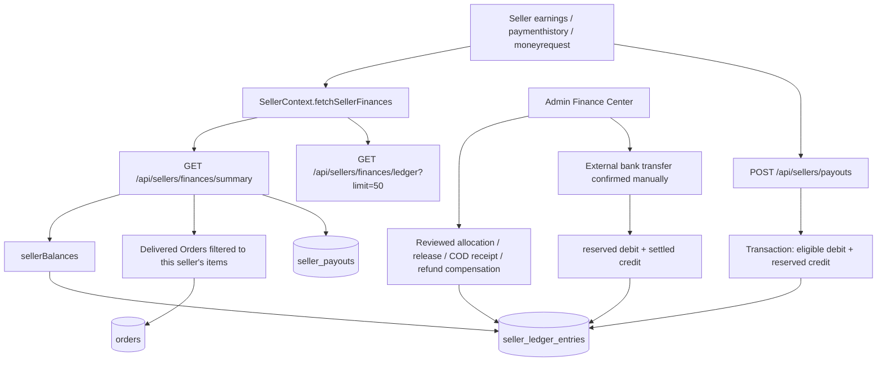
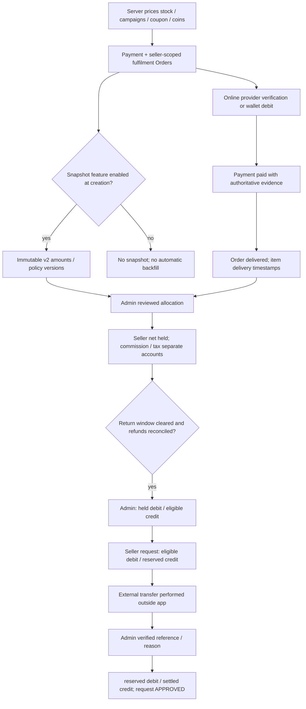
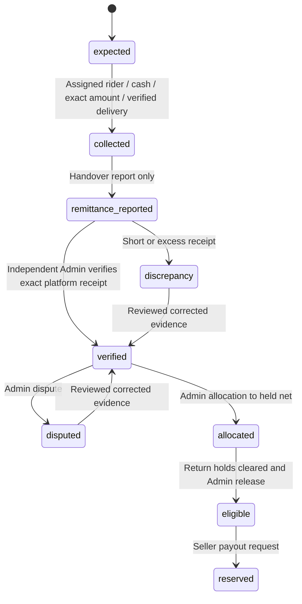

# Seller Earnings financial forensic audit

Audit date: 2026-10-23, Asia/Calcutta. Scope: current working tree and read-only inspection of the configured `bulkimart` database. **Initial findings were written before application corrections.** Final verification and safe changes are recorded at the end. No live reconciliation, posting, payout, refund, order mutation, flag change, migration or index creation is authorized or performed by this audit.

## 1. Executive conclusion and evidence boundaries
      
The Seller Earnings module is API-driven and backed by an append-only settlement subledger. It is **partially implemented, gated, and not established as production-ready end to end**. Delivered merchandise sales, verified payment, ledger entitlement and bank receipt are separate facts. The screenshot's ₹1,150 is delivered item sales, not a confirmed payable balance.

Verified configured-database facts:

- Both specified orders exist, belong to seller `6ace1e155e84238166d1e47a`, and have `status: delivered`.
- `ORD-20261015-K2OCHK`: ₹250 online Payment marked paid, with legacy Razorpay capture metadata, but no current capture journal or financial snapshot. Item delivery timestamp is absent despite the delivered order status.
- `ORD-20261019-CIRFK5`: ₹900 item sales, ₹20 customer delivery charge, ₹920 COD Payment still pending. Its rider Delivery is delivered and OTP verified, but there is no `codFinance` collection/remittance/receipt record.
- Neither order has `financialSnapshot` or `financialPosting`; neither has a linked Return. Neither has a Quick freight snapshot.
- The entire inspected database contains **0 seller ledger entries, 0 seller payouts, 0 Quick financial snapshots**. All 16 orders inspected by the coverage aggregation lack version-2 financial snapshots. There are 15 Payment records and three legacy Commission documents, with **no version-2 commission rule**.
- Configured-process flags for snapshotting, operations and payouts are false; policy and end-to-end approval references are absent. This establishes the probe's current configuration, not historical settings or an independent deployment's environment.

Thus each screenshot zero is the genuine sum of an empty **posted ledger**, not proof that the business owes nothing for historical orders. The missing snapshots prevent an authoritative historical net calculation. No amount should be credited from ₹1,150 or from today's legacy/default commission rate.

Separate verified presentation defects: failed requests clear finance data, after which missing values are formatted as ₹0.00; malformed HTTP-200 response bodies are accepted as empty data; payout empty-state text can misrepresent failure. These can be corrected without altering financial outcomes.

Evidence files:

- `test-artifacts/seller-earnings-audit/database-evidence.json`: bounded raw financial projections, counts, indexes and configuration booleans, observed at `2026-10-23T07:34:10.476Z`. No bank-account values, customer addresses or contact details were requested.
- `test-artifacts/seller-earnings-audit/reference-inventory.txt`: 6,164 keyword-search matches across repository source, tests, scripts, configuration code and operational Markdown, including every requested keyword. Generated artifacts, dependencies, build output, private data and secret environment files are excluded. Matches are an investigation index, not proof of implementation.
- `backend/scripts/auditSellerEarningsReadOnly.mjs`: reproducible read-only probe. It uses MongoClient directly, never imports server startup/models/seeds, and never runs financial functions or provider calls. Credentials are not printed. Network escalation was approved for this read.

The project's graph tools were sought first but are not exposed in this session. Targeted `rg` and source reads were the fallback. Existing uncommitted changes predate this audit and were preserved. No authenticated live Seller/Admin token was supplied: live protected API payloads, bank statements, deployment logs, historical environment history and gateway/bank reconciliation were not independently obtained. Database inspection and actual isolated authenticated HTTP tests are distinguished throughout.

## 2. Screenshot orders and missing-snapshot diagnosis

| Fact | Online order | COD order |
| --- | --- | --- |
| Order number | ORD-20261015-K2OCHK | ORD-20261019-CIRFK5 |
| MongoDB Order ID | `6ad12739e87a768124c73d2a` | `6ad5ed0549802e193bd99c1e` |
| Created, UTC | 2026-10-15 19:19:21.489 | 2026-10-19 10:12:21.862 |
| Delivered timeline, UTC | 2026-10-15 19:20:27.274 | 2026-10-19 10:59:45.745 |
| Seller ID, both item-level | `6ace1e155e84238166d1e47a` | Same |
| Item ID | `6ad12739e87a768124c73d2b` | `6ad5ed0549802e193bd99c22` |
| Quantity × frozen item price | 1 × ₹250 | 1 × ₹900 |
| Discounts / delivery / payment total | ₹0 / ₹0 / ₹250 | ₹0 / ₹20 / ₹920 |
| Payment ID | `6ad12739e87a768124c73d29` | `6ad5ed0549802e193bd99c20` |
| Payment state | online, paid | cod, pending |
| Funding evidence | Legacy gateway metadata reports captured UPI and signature verification; current `captures` journal absent. No provider lookup performed. | `captures:[]`; no `codFinance`, collection/remittance/receipt evidence absent. Physical cash location unknown. |
| Fulfilment evidence | Delivered Order status; no Delivery found and item `deliveredAt` absent. Why the old transition marked it delivered is not established. | Manual fulfilment; Delivery `6ad5f219b0b594522028bc2d`, rider `6ace0db57215e956fec34ea4`, delivered, OTP verified; item deliveredAt present. |
| Returns | No matching Return; returnedQty 0; nonreturnable frozen policy | Same; no return deadline |
| Merchandise snapshot / posting | Both absent | Both absent |
| Quick freight snapshot / seller ledger / payout | None | None |

Exact warning source: `EarningsTab.jsx::settlementStatus` tests `snapshotVersion !== 2` when no `financialPosting` exists. The summary projects `snapshotVersion` from **Order.financialSnapshot.version**, not from the separately named QuickCommerceFinancialSnapshot collection. These are two different snapshot systems; absence of a Quick snapshot is not itself the merchandise-snapshot warning.

Snapshot creation belongs to `Order.js::pre('validate')`: only a **new** Order with `FINANCE_SNAPSHOTS_ENABLED === 'true'` invokes `vendorCommission.service.js::buildOrderFinancialSnapshot`. Existing orders are never populated on reads or later delivery. Missing rules on enabled new orders produce `held_missing_rule`, not an absent snapshot. Calculation/query failures propagate rather than silently yielding a zero snapshot.

Both orders predate the implementation date documented in `FINANCIAL_WORKFLOW_IMPLEMENTATION.md` (21 October). **Likely explanation:** legacy orders created before activation while snapshotting was disabled/unavailable. **Proven boundary:** they currently have no snapshot, creation is gated, all sampled orders lack snapshots, and no backfill path runs. Historical flag/process logs were not available, so the exact creation-time configuration cannot be proved from present state.

`orderSweeper.service.js::startOrderSweeper` runs every 30 seconds for stale Quick cancellations, Coins return-window rewards, notifications, pickup sync, advertising and parcel assignment. It does **not** create merchandise snapshots, allocate seller earnings or release seller funds. `financialReconciliation.service.js::financialReconciliation` is an Admin-triggered **read-only report**, not a repair job, and selects only version-2 orders. These legacy orders are therefore excluded from that reconciliation view. A scheduler failure is not needed to explain their absence. No job execution logs were inspected.

Indexes: event-key and entry-number uniqueness on seller ledger, payout-key uniqueness on seller payouts and Quick snapshot order uniqueness exist. Version-2 monitoring/rider-balance/commission-effective indexes proposed by `prepareFinanceWorkflowIndexes.mjs` are not present among inspected ledger/commission indexes. Missing query indexes are a rollout/performance concern, not evidence that a snapshot was written under a wrong identifier. The probe did not inspect the full orders index list or every collection; no wider index-completeness claim is made.

## 3. Frontend → backend → storage map

| Surface / function | Endpoint | Source, scope and transform |
| --- | --- | --- |
| DashboardPage → EarningsTab | `/seller/earnings` | Uses SellerContext only; no local sales/commission formula for authoritative balances. |
| SellerContext.fetchSellerFinances | Summary + ledger routes above | Parallel portalRequest reads with sellerToken, generation/session-change guard and request timeout. A failure clears all finance state. Initially accepted missing data as null/[] without schema validation. |
| sellerFinance.controller::getSellerFinanceSummary | GET `/api/sellers/finances/summary` | `ownSeller` derives seller from authenticated user/approved profile. Aggregates ledger balances, real payout documents and all-time delivered Orders. Sales `$filter` isolates matching seller items before summing `price*qty`; recent order list limited to 20, totals all matching orders. |
| sellerFinance.controller::listSellerLedger | GET `/api/sellers/finances/ledger` | Own seller only; optional bucket/type; default limit25, frontend requests50; no date filter in this page. No wrong-ID/date-range explanation for globally empty ledger. UI has no pagination controls for older rows. |
| OrderFinancialBreakdown | GET `/api/sellers/orders/:id/financial-breakdown` | Own seller must appear in Order items. Returns Quick snapshot, filtered merchandise lines and scoped ledger. **Risk:** copied merchandise snapshot still includes order-wide components/expected total; label these as order-wide, never seller entitlement. |
| MoneyRequestTab / handleRequestPayout | POST `/api/sellers/payouts` | Requests rupees; backend validates/fences/reserves funds. UI generates a new `Date.now()` key per attempt; retries do not reliably reuse the original business request. |
| PaymentHistoryTab | Summary `payouts` | Real SellerPayout documents, not bank transactions fetched from a provider. APPROVED means manually recorded settlement under the current route. |
| Admin SellerLedgerAdminTab | GET `/api/admin/seller-balances`, `/seller-ledger`, `/vendor-payouts` | Real seller ledger sums and payouts; manual evidenced settle/reject routes. |
| Admin FinanceWorkflowTab | GET `/api/admin/finance/commissions`, `/orders`, `/ledger`, `/reconciliation` | Real versioned configuration, frozen order data, ledger and read-only exception report. POST reviewed allocate/release/COD/return reversal calls services below. |
| Admin QuickThirdPartySettingsTab | `/api/admin/quick-commerce-third-party-config`, `/quick-commerce-shiprocket-fees`, `/financial-reconciliation` | DB config and Quick snapshot records; policy/capability gates; final courier-freight reconciliation remains manual/incomplete. |
| Admin VendorFinancialsTab, sales view | GET `/api/admin/vendor-sales` | **Non-authoritative estimation**: aggregates item gross from broad status filter, guesses `seller.commissionRate || 5`, synthesizes order/status fields. Must not authorize payout. |

Seller routes apply `protect`, seller-session context and approved-seller gate. Seller IDs supplied by callers are not used for own balances. Admin finance routes apply `protect, requireAdmin` globally; **there is no per-finance permission check or enforced two-admin payout approval** on these finance endpoints. Service/advertising permission guards elsewhere do not protect this merchandise finance surface.

## 4. Placeholder and zero-value inventory

Classification: **API** = implemented/API-driven; **incomplete** = real data but semantics/connection incomplete; **placeholder** = static/demo/default; **blocked** = configuration/integration gated; **unverified** = not established in this audit.

| Section / value | Classification and evidence |
| --- | --- |
| Earned earnings | API: `sellerBalances` sums seller_payable `order_earning` **credits over all time**. It is cumulative posted original net, not remaining withdrawable balance and not reduced by refund debits. Here ₹0 because there are no rows. |
| Pending / Held / Eligible / Reserved / Settled | API: signed credit-minus-debit sum for each payable bucket. All zero from zero documents. Held may be negative after a post-payout refund; this is explicit debt and blocks payouts. |
| Quick freight obligations | API: cumulative debits of type `quick_freight_obligation`, not current outstanding payable after collection/refund. Here zero; no Quick snapshot or obligation. |
| Bulkimart service fees | API: cumulative `quick_service_fee` debits, **not merchandise commission**, not gross customer order fees and excludes separate quick_fee_tax. Here zero. |
| Gross ₹900 / ₹250 and combined ₹1,150 | API: frozen Order item prices × quantities, correct seller scoping. Before order-level reductions; product deal price may already be discounted. These are reporting sales, not ledger credits. |
| Missing-snapshot label | API-derived conditional described above. Correct for both orders. No snapshot is fabricated as a zero-valued transaction. |
| Empty order ledger | API-driven; database independently empty globally. UI only retrieves latest50. Failed reads previously also emptied this array; failure and empty must be distinct. |
| Payout requests below fold | API-driven SellerPayout list; no payouts in configured database. Existing summary failure/missing response could incorrectly render “No payout requests.” |
| Failed/missing summary formatted as zero | **Verified presentation defect**: `EarningsTab`/`MoneyRequestTab` use balances fallback `{}` and `Number(value || 0)`; loading/error states must not imply financial zeros. |
| HTTP200 missing/false success/malformed numeric values | **Verified response-handling defect**: SellerContext originally tests only HTTP status, accepts data||null/[], and number formatters coerce missing values to zero. Safe correction planned. |
| Initial no-data render / MoneyRequest loading | Placeholder/default masks state: no loaded summary can show zero and “No eligible balance.” Must show unavailable/loading instead. |
| Commission chart / demo transactions in current EarningsTab | No chart or hardcoded transaction array found. Colors, labels and informational copy are static decoration, not financial data. |
| CommissionSimulation | Explicit browser-only sample calculator; starts with empty approved rates, creates no records. Never authoritative. |
| Admin Tax and Settlement Policies screen | Explicit static placeholder/policy notice; no standalone general GST/escrow/settlement-schedule editor exists. Links route to actual commission and service-fee forms. |
| priceOrder.discount / cdsDiscount | Explicit current placeholders zero; product campaigns lower item.price upstream. **Stored Order.discount includes coupon alias in single checkout**, creating the mismatch below. |
| Legacy commission seed / Seller.commissionRate | Seed has assumed 10% general and 6%+₹5 category example; Seller default10. Not approved v2 financial rules. Current inspected commission documents also include SHG0. |
| Legacy Admin vendor-sales estimates | Hardcoded fallback5%, tax calculation18% (computed value not applied to net), payment label Online/COD, seller-derived fake order ID, delivered status from approved Seller status; order count increments per item. Sales route remains reachable. |
| Old getVendorPayoutsAdmin / settleVendorPayoutAdmin | Legacy synthesized payout logic remains as exported dead code; current admin route wires ledger-aware replacements. Do not mistake unused code for an active bypass. Legacy VendorFinancialsTab can still navigate its own subtabs from sales, but its old settle payload lacks required verified/reason evidence and is rejected by current backend. |
| Automated bank payout, transfer statuses, payout webhook | Absent for Seller payouts. The app records Admin-confirmed external transfers; PENDING/APPROVED/REJECTED are the model's only statuses. No processing/success/reversal provider lifecycle is connected. |
| Escrow | Held ledger bucket exists. No independent escrow/bank account, escrow-provider integration or proof of segregated cash was found. A held liability is not proof that cash is in escrow. |

## 5. Calculation rules and actual configuration

**Units:** Order pricing, Payment.amount, SellerLedgerEntry.amount, SellerPayout.amount and Quick snapshots use rupees. Order.financialSnapshot uses integer paise. `moneyPaise` validates finite nonnegative numbers with at most2 decimals, rounds rupees×100 and rejects unsafe values. Ledger posting divides snapshot paise by100 once. Frontend seller money formatting expects rupees; Admin FinanceWorkflow formats paise and converts ledger rupees×100 for its helper. No legitimate ₹1,150→115,000 payable conversion exists.

### Authoritative v2 merchandise formulas

For item line i:

1. `grossPaise_i = moneyPaise(item.price) × qty` (item.price may already contain a product campaign/wholesale deal).
2. Discount components are currently read as `discount`, `couponDiscount`, `cdsDiscount`, `coinDiscount`. `allocatePaise` apportions combined reductions by gross weight using integer largest remainders, then conserves each component across line budgets. Tie-break is original line index.
3. `eligiblePaise_i = grossPaise_i − sum(allocatedDiscounts_i)`.
4. Rule selection: same physical/sales channel, vendor general/SHG, effective date <=now; newest version per product/category scope, then specificity product > category > channel default. Explicit disabled versions supersede the same scope; less-specific enabled fallback may remain. Legacy documents without financeVersion2 are never used.
5. Charge: fixed `moneyPaise(value)` **once per order item**, or rounded `eligiblePaise × percentage/100`; apply configured minimum/maximum. Fully discounted line charge=0. Percentage/tax ratios use integer BigInt half-up calculations.
6. Exempt: commission=charge, tax=0. Exclusive: commission=charge, tax=rounded charge×taxRate/100. Inclusive: commission=rounded charge/(1+taxRate/100), tax=charge−commission. Reject if commission+tax exceeds eligible.
7. `sellerNetPaise_i = eligiblePaise_i − commissionPaise_i − commissionTaxPaise_i`.
8. Frozen expected payment = total eligible merchandise + delivery + tip + donation; must equal `pricing.totalAmount` exactly in paise. Commission excludes delivery/tip/donation. No separate product GST/taxable-item-base field exists; commission tax is not automatically product GST.

**Verified release blocker:** `order.controller.js::createOrder` stores `pricing.discount = pricing.discount + pricing.couponDiscount` while also storing `couponDiscount`. `priceOrder` currently supplies discount0. Snapshot creation subtracts both fields. For ₹100 merchandise with ₹10 coupon, the stored shape is discount10, couponDiscount10, total90; the snapshot computes merchandise80 and rejects its total reconciliation. This is a source-level contradiction, not an approved second discount. The correct repair requires an explicitly reviewed normalization of the legacy alias across checkout, refunds and snapshots. No backend financial change is made by this audit.

**Other discount limits:** unified multi-delivery checkout explicitly rejects a coupon instead of allocating an unapproved basket-wide discount. Orders are split by seller/channel/delivery group; each carries its own group's items and total. Seller-paid campaigns alter that seller's item price. Coupon/Coins funding ownership is not represented in the v2 snapshot: all modeled discounts reduce seller eligible merchandise. There is no implemented platform-funded reimbursement/sponsor allocation; business approval is required before describing such reductions as seller-funded. Split-refund rounding uses a different mechanism (see below).

Paid advertising is another separate flow: `advertisingBilling.service.js` posts advertiserSellerId/advertisingCampaignId and advertising cash/liability/tax/revenue accounts. Its ledger model validation forbids merchandise sellerId/orderId references on advertising postings. These do not become seller_payable earnings or automatically deduct from merchandise payouts. A campaign price reduction, an advertiser's service purchase and a platform-funded subsidy are not interchangeable financial events.

### Current actual Commission records

| ID | Vendor/scope | Legacy values | Authoritative v2 applicability |
| --- | --- | --- | --- |
| `650500000000000000000001` | general, all categories | 10%, flatFee0, active | None: financeVersion/channel/method/tax treatment/version absent |
| `650500000000000000000003` | general, category `650000000000000000000004` | 6%, flatFee₹5, active | None: same missing v2 fields |
| `650500000000000000000002` | SHG, all categories | 0%, flatFee0, active | None: same missing v2 fields |

These are configured database values, **not a justified rate to deduct from the two orders**. No v2 rate, approved GST treatment, provider fee deduction or historical commission contract was found for them. Therefore this audit does not compute a guessed seller net.

### Quick freight and service fees (separate system)

`quickCommerceFinance.service.js::calculateOptionB`:

- Customer freight contribution = min(customer delivery charge, verified eligible courier freight).
- Vendor freight share = max(0, courier freight − contribution).
- Service charge = configured flat rupees or percentage of explicitly selected courier-freight/vendor-share base, with optional min/max.
- Inclusive/exclusive/exempt service-fee tax applied from that rule.
- Vendor obligation = vendor freight share + service charge gross including applicable tax.

`recordQuickCommerceObligation` posts held freight/service-fee/tax debits with immutable snapshot; `settleQuickShiprocketCollection` posts a separate verified seller fee-payment credit, clearing the obligation rather than deducting it again from merchandise. A stale comment says no live route invokes the primitive; **actual caller** is `quickShiprocketFee.controller.js::initiateQuickShiprocketFee`, behind quote/provider/config gates. This code is connected but gated, not universally absent.

Final provider freight, customer delivery surplus treatment, cancellation/reverse-logistics allocations and fee-refund adjustments need approved configuration/reconciliation. Neither screenshot order has such an obligation; ₹20 customer delivery charge must not be labeled a seller Quick freight debit.

Quick snapshots freeze `accountingStatus` and `finalProviderFreight` as immutable fields. Creation records a pending obligation; the separate seller collection settles Payment and posts a credit, but does not establish final courier-freight reconciliation. A pending/missing-final-freight report must not be interpreted as a functioning scheduled true-up worker.

### Balance meanings

`bucketBalance = Σ(payable credits) − Σ(payable debits)` for this seller, account seller_payable (legacy rows without account also included).

- Held/pending: posted liabilities/debt not withdrawable.
- Eligible: released balance available to reserve, **subject to current payout gates, outstanding returns and COD disputes**.
- Reserved: eligible funds already committed to a pending request; cannot be reserved again from eligible.
- Settled: cumulative recorded paid bucket, not a new bank feed.
- Earned earnings: original net order-earning credits, not net after reversals.
- Remaining immediately reservable amount: eligible, if held>=0 and all server eligibility checks pass; do not add reserved/settled back.
- Freight/service-fee cards: cumulative debit activity, not balances cleared by credits.
- `sellerBalances.reversals` currently sums reversal credits, while merchandise return reversal entries are debits; this secondary metric can miss refund compensation. `adjustments` sums inter-bucket adjustment credits/debits and can net zero even when eligibility changed. Neither is a bank reconciliation result.

## 6. Prepaid and wallet lifecycle

Checkout functions: `order.controller::createOrder/createUnifiedOrder`; `fulfilmentOrders::createOrdersFromGroups`; pricing.service, coupon.service, inventory mutation, checkout idempotency/claim and wallet services. Unified uses one Payment/groupRef and separate seller fulfilment Orders; tip goes once to first eligible group. It does not assign full basket sales to each seller.

`payment.controller::initiatePayment/verifyRazorpayPayment/razorpayWebhook/settle` and Razorpay service verify signature, provider amount/currency/order linkage and capture. Duplicate exact captures are no-ops; extra/late captures create refund obligations rather than fulfil/credit twice. Authorization alone is not captured money. Legacy gateway replay can populate capture evidence only through the verified provider settlement flow; this audit did not replay anything. PhonePe compatibility routes exist, but current seller merchandise allocation specifically demands the current captured journal for online payments; non-Razorpay compatibility is not established.

Wallet uses existing `debitWallet`/WalletLedger, not SellerLedger. Wallet order allocation requires paid Payment plus matching completed wallet-debit evidence. Wallet balances are mutable user totals updated with their ledger; they are not seller balances.

Delivery completion: rider `verifyDeliveryOtp` or seller courier `updateOrderStatus` stamps item delivery/return deadlines. Rider completion can post rider earnings held for v2 orders via `recordDeliveryEarning`; **it does not post seller merchandise earnings**.

`orderFinance::postOrderFinance` requires released operations, transaction, v2 configured snapshot, delivered state and verified payment. It posts one set per item: seller net into seller_payable held; commission into commission_revenue; commission tax into tax_liability; merchandise gross as reporting dimension. Customer delivery charge is a separate account. This is a subledger with reporting dimensions, **not a complete balanced statutory double-entry ledger**.

`releaseOrderFinance` is explicit Admin action after funding, item timestamps, expired return deadline and reconciled Returns. No timed automatic seller settlement exists. Payment-gateway fees/bank settlement charges are not fetched/applied to seller net; captured amount is not proof of platform bank settlement. Gateway/bank reconciliation remains unverified.

## 7. COD lifecycle and custody

`recordCodEvent` supports only cash collected by the **assigned delivery partner**, tied to a completed OTP-verified forward Delivery. Seller/manual-courier cash collection without such a Delivery has no alternate reviewed COD finance path. Counter cash/pay-at-store and zero-value COD need separate approved policy. Physical possession is unverified for the screenshot COD order.

Collect posts cod_custody credit; remit records evidence without marking paid; verify checks the reporter is not the verifier, posts custody deltas and separate excess-liability deltas, and records shortages/excesses/disputes. A repeated reference must match amount/actor/reason. Payment becomes paid only after every sibling order's cash is verified. COD allocation cannot use pending Payment as prepaid money; it requires codFinance verified/allocated with exact frozen expected amount. Outstanding/unverified/disputed cash cannot release earnings. These guarantees depend on the versioned workflow being enabled and records being present; they do not retroactively establish legacy custody.

No cash collection/remittance was inferred from the COD order's OTP, ₹216 legacy rider earning or delivered state. The ₹920 is a customer collection obligation, not Bulkimart revenue or seller net.

## 8. Returns, cancellations, exchanges and partial adjustments

Return lifecycle (`return.service.js`): eligibility uses frozen per-item return policy/deadline, customer ownership and remaining quantity; quantities are atomically reserved. Approval/pickup/receipt precede refund. Refund breakdown is frozen on first attempt. Wallet refunds credit the customer wallet; online refunds use provider verification/recovery; COD refunds remain manual_pending until Admin records settlement. Manual COD completion uses `MANUAL-COD` plus actor/note, not an independently verified bank transfer integration.

`calculateReturnRefund`: returned unitPriceSnapshot×quantity minus independently rounded gross-proportional coupon, legacy CDS and Coins allocation. Delivery is not refunded under current code; no product GST component exists. This differs from cumulative conserved-paisa snapshot allocation and ignores the duplicate `discount` alias. Certain tiny multi-item/partial-return rounding combinations can differ; `reverseRefundedReturn` **rejects** a mismatch rather than silently adjusting historical entitlements.

Refund execution does not automatically post seller compensation. Admin must call `POST /api/admin/finance/returns/:id/reverse`. It checks REFUNDED plus refund reference, original snapshot/posting and cumulative quantity; computes original frozen eligible/commission/tax proportions; appends debit reversals to payable/commission/tax/gross and durable processed markers. Original entries are unchanged. After settlement or inadequate eligible balance, uncovered net becomes held debt. The seller fence serializes refunds against payout reservation/settlement. Zero-value refunds have null provider reference in return.service but reversal requires a reference: **isolated regression confirms the reference-free zero-value return is rejected**, leaving a release/reconciliation blocker until a reviewed policy correction.

`releaseOrderFinance` first requires a paid non-COD Payment, while a real online partial/full refund changes Payment.status to partial_refund/refunded. **An added isolated regression confirms** that a partially refunded Payment prevents release even after its Return compensation reduces held net correctly. Existing tests that manually create a REFUNDED Return without changing Payment status do not establish that integration. This is a financial correction candidate, not changed here.

Cancellation (`cancelOrder`, `cancelOrderAndRestore`, `coordinateOnlineCancellation`): atomic status claim, inventory/coupon restoration; wallet cancellation returns money with scoped idempotency; paid online cancellations create existing refund obligations/markers for recovery, not a claimed completed refund. Late capture creates debt rather than fulfilling again. Shared Payments use per-order amounts/group links. Seller entitlement cannot accrue from a cancelled order; already-posted terminal orders are blocked by settlement eligibility until reviewed. There is no generic automatic seller-ledger cancellation/reverse-logistics compensation policy.

No customer exchange/replacement Order financial workflow was found in the repository search. Comments about replacing documents/indexes are not exchange implementation. Return refund plus manual repurchase is not an established exchange accounting lifecycle. No approved reverse-logistics cost allocation across seller/platform/customer was found.

## 9. Payout request, reservation and Admin controls

Actual Seller states: `PENDING → APPROVED` after manual verified paid-transfer evidence; `PENDING → REJECTED` with reservation compensation. Request creation is **not** transfer success. Approval here is the persisted name for a confirmed settlement, not an automatic transfer initiation.

1. `requestSellerPayout` checks financial payout flag + approval references, derives Seller from authenticated profile, validates positive two-decimal rupee amount and seller-scoped idempotency key. Existing identical request replays; differing amount conflicts.
2. Mongo transaction fences Seller.financialLedgerVersion; rechecks replay, authoritative eligible balance, nonnegative held debt and return/COD/terminal-order blockers; creates PENDING SellerPayout with bank-details snapshot; posts eligible debit/reserved credit and references entries. Concurrent requests serialize on Seller, preventing two requests spending the same available funds.
3. **Missing business/security controls:** no seller minimum-payout threshold, payout-fee rule, verified-bank state, external beneficiary validation, account-change approval or same-destination uniqueness check is enforced by this handler. Copying seller.bankDetails is not bank verification. No bank account details were read during audit. The rider minimum is not a seller minimum.
4. `settleSellerPayoutLedgerAdmin`: requires payout release gates, verified=true, reason>=5 and transaction reference>=4 characters. Finds PENDING request and matching credit reservation, rechecks seller debt/settlement blockers, posts reserved debit/settled credit, sets APPROVED, actor/time/reference. Repeat same approved reference is idempotent. No provider API sends money. Reference is not globally unique across payouts and is not verified against bank statement/provider; a reused bank reference can be falsely attested for a different request. Separate reviewer/dual-control is not enforced.
5. Rejection requires pending reserved request and reason, returns reserved→eligible via new entries, sets REJECTED. No edit/deletion of financial history. Repeated rejection is no-op. No seller-cancellation endpoint found.
6. No automated Seller transfer-pending/processing/failed/reversed lifecycle, payout-provider webhook, beneficiary API or transfer-retry/reversal reconciliation exists. `failureReason` field alone is not an implementation. `reconciliationReason` stores attestation text, not uploaded immutable bank evidence. Seller payout notifications are not emitted by these handlers; seller sees records on refresh. Customer/rider notifications elsewhere must not be mistaken for this integration.

**Crash boundary:** request/reservation and confirmed settlement are transactional internal operations. A real external transfer before internal confirmation can leave PENDING until Admin reconciles. Transaction failure after the external transfer is not safely resolved by sending again; existing reference and bank statement must be checked. No complete automated external-transfer exactly-once guarantee can be claimed.

## 10. Ledger invariants, escrow and reconciliation coverage

| Invariant | Verified implementation / limit |
| --- | --- |
| Immutability | SellerLedgerEntry save/update/delete/replace/bulkWrite hooks deny edits; append compensating entries. Raw collection access/DB credentials bypass these model guards. Commission versions append-only. Order snapshot save/update replacement guards exist; raw/bulk maintenance still requires review. |
| Idempotency | Unique entryNo/idempotencyKey indexes; postLedgerEntry verifies owner/amount/order/payment/bucket/type/account on replay; payout keys seller-scoped and unique/sparse. Metadata/description/actor/currency checking is not universally exhaustive for ordinary seller rows. |
| Atomic reservation | Transactions and Seller write fences bind balance check/reservation/refund debt. Replica-set topology required; financialTransaction fails closed instead of standalone fallback. Payout handlers also use withTransaction directly. |
| Derived seller balances | Aggregated ledger rows, not Seller.balance/earnings counters. No mutable seller available-total to drift. Rider earnings counters coexist and read-only reconciliation compares them to rider ledger, bounded to100 riders. |
| Currency and precision limits | Controlled merchandise services convert integer paise to INR ledger rupees. Generic ordinary seller ledger schema/helpers do not universally enforce INR-only precision, and sellerBalances does not group/filter by currency. A future/raw non-INR posting could mix units; no such rows exist in the inspected empty ledger. This is an invariant to harden before extending posting sources. |
| Negative balance policy | Negative held debt explicitly possible after paid refund. Payout rejects held<0. No broad schema invariant forbids arbitrary negative eligible results from privileged/raw postings; current controlled paths check availability. |
| No double count | Payable account only for seller balance; commission/tax/gross accounts do not increase it. Quick collection credit offsets separate freight/fee debits. Gross reporting and payouts are not summed into earned net. |
| Reconciliation | Checks version2 component totals, missing allocation, account amounts, cash custody/disputes, missing Payment/return compensation, duplicate keys and negative buckets. Not a complete bank/cash/gateway general-ledger reconciliation; version2 only, page50, riders100, negative/duplicate list limits100. |
| Payout receipt | Admin attestation only, no independent bank confirmation or unique transfer receipt allocation. Ledger can internally balance while bank evidence is wrong. |
| Historical coverage | Explicitly false in APIs; legacy delivered orders excluded from v2 reconciliation and cannot be auto-allocated. This is intentional safety behavior but must be visible to operators. |

## 11. Responsibilities and configuration boundaries

**Automated in current connected paths:** checkout/payment idempotency, payment verification/capture journal, price snapshot creation when enabled, return eligibility/quantity locking, rider OTP physical completion and v2 held rider posting, ledger transaction atomicity, webhook/refund recovery, scheduled operational/Coins jobs. None automatically allocates historical seller merchandise earnings or initiates Seller bank transfers.

**Seller:** accepts/fulfils eligible orders, selects allowed fulfilment, separately pays Quick freight fee where configured, supplies payout destination and requests only eligible funds. **Rider:** assigned cash collection/remittance report. **Admin:** commission versions, activation approvals, independent COD receipt, allocation, return review/refund/compensation, seller/rider release, real external transfer and evidenced settlement/rejection.

| Dependency | Existing control |
| --- | --- |
| Financial snapshot / operations / payouts | FINANCE_SNAPSHOTS_ENABLED / FINANCE_OPERATIONS_ENABLED / FINANCE_PAYOUTS_ENABLED; policy and E2E approval references; no flag altered by audit. |
| Transaction/index rollout | MongoDB replica set or supported sharded topology; `prepareFinanceWorkflowIndexes.mjs` dry-run default; applying requires FINANCE_INDEX_APPROVAL_REFERENCE. Never run --apply here. |
| Online payment | PAYMENT_GATEWAY, RAZORPAY_MODE, RAZORPAY_KEY_ID/SECRET, RAZORPAY_WEBHOOK_SECRET and existing callback checks. Secret values not read into report; live integration not tested. PhonePe compatibility is separate/unverified for v2 seller capture allocation. |
| Quick freight | QUICK_SHIPROCKET_SELLER_COLLECTION_ENABLED, DB QuickCommerceDeliveryConfig effective policy/fee/version, Shiprocket environment/capabilities, verified quote/pickup, payment environment. No approved current live fee rule established by the scoped database probe. |
| Bank payouts | Manual banking operation outside app. No Seller payout API provider credential integration found. |
| Financial tests | Isolated MongoMemoryReplSet and mocked providers; sanitized runner removes developer database/provider/deployment environment. Passing tests are not policy approval or production authorization. |

## 12. Findings and risk register

| Severity | Verified finding / risk | Recommended action; financial approval boundary |
| --- | --- | --- |
| High | Historical delivered sales with no snapshot/funding reconciliation have unknown entitlement, though posted balances zero. | Display “no posted funds / historical reconciliation required”; prepare reviewed per-order historical evidence, never synthesize credits. |
| High | Single checkout coupon alias is subtracted twice by v2 snapshot calculation. | Reproduce in isolated test; separately review normalization against return/cancellation/legacy data before enabling snapshots. |
| High | Finance errors/malformed successful responses can appear as zero/empty finance state. | Safe frontend validation and unavailable/error states; no money changes. |
| High | Seller payout destination is copied without verification; settlement is attestation without unique bank-reference enforcement or transfer provider. | Define bank verification and receipt allocation/dual control; do not claim automated payout readiness. |
| High | Broad Admin authority on merchandise finance; no enforceable finance-specific/dual approval gate. | Review manage_finance permissions and separation of duties as a backend authorization change. |
| High | Actual partial refund Payment status may prevent release of the unaffected net. | Add integrated provider-refund→compensation→release tests and approve revised funding evidence logic. |
| Medium | Zero-value completed refund lacks reference required by compensation path. | Isolated regression and approved zero-value reconciliation rule. |
| Medium | Legacy Admin sales estimates use assumed commission/status/order IDs and counts. | Remove/label estimates and use versioned ledger for finance; do not migrate estimated values to payable. |
| Medium | Reconciliation excludes all historical orders and has bounded coverage; no automatic repair/job. | Expose historical exception coverage and reviewed report-only backfill manifest. |
| Medium | Payout UI generates fresh keys per retry; double clicks can create multiple valid requests if total funds permit. | Separately review stable business-request key and submission lock; backend prevents overspending but cannot infer duplicate human intent. |
| Medium | Funding source of coupons/Coins, merchandise GST, gateway fees, reverse logistics and exchanges not fully modeled. | Obtain approved policies; avoid silently choosing seller-funded deductions. |
| Medium | Return allocation rounding and snapshot cumulative allocation differ; block on disagreement. | Add integrated multi-item partial-refund tests; approved deterministic shared allocation policy. |
| Low/Medium | Ledger history limited to latest50; earned/freight/fees cards cumulative activity, not outstanding balances. | Clarify descriptions and bounded history; future pagination within read-only scope. |

## 13. Historical repair proposal — report only, not implemented

No data repair is justified merely to remove the warning. The report-only manifest `test-artifacts/seller-earnings-audit/historical-reconciliation-dry-run.json` was generated from the saved read-only evidence, without executing against the live database. It classifies both orders as blocked, leaves proposed payable null and proposes zero ledger entries. Prepare a separate reviewed plan:

1. Approved read-only manifest per Order/item/seller/Payment/capture/return/delivery, original policy contract/version, gateway/bank/cash evidence and all existing postings. Identify missing line-delivery evidence and COD handover. Historical entitlement cannot use a newly approved commission retroactively without explicit agreement.
2. Dry-run classification: excluded legacy; evidence incomplete; ambiguous policy; already reconciled; proposed amount only after all approvals. For the two audited orders, **proposed payable=null, blocked**, reasons missing historical commission/snapshot, legacy capture/delivery evidence or unverified COD. No proposed automatic ₹1,150 credit.
3. Duplicate checks on Order+item+event revision and all historical ledgers/payment refunds/payout reservations. Add approved unique migration event key; compare payload hash on retry. Never overwrite immutable snapshot/ledger to satisfy validation.
4. Reconcile external cash first; choose explicit audited legacy-adjustment mechanism compatible with existing ledger rather than forcing new snapshots through guards. Transactionally post only approved delta with seller fences and durable batch/actor/policy/evidence references.
5. Rollback is compensating entries and batch quarantine, not deletion/edit of posted money. Money already transferred cannot be rolled back by deleting a row; reconcile bank reversals separately. Dry-run/review/apply phases need separate authorization and restore rehearsal.

## 14. Audit-stage correction and verification record

At initial report creation, no application correction or backend financial modification had been made. Read-only probe and search evidence were complete. The following subsequent corrections are read/presentation changes only; backend policy/calculation/data repairs identified above remain separate review items.

### Implemented safe corrections and exact changed files

| File | Change and purpose |
| --- | --- |
| `forntend/src/modules/Seller/utils/sellerFinanceRead.js` | New response validator and rupee formatter. Rejects false-success envelopes, absent/nonfinite/numeric-string balances, malformed sales/payout arrays and invalid ledger structures. Does not calculate or alter funds. Valid numeric zero remains zero; missing amounts format as an em dash. |
| `forntend/src/modules/Seller/context/SellerContext.jsx` | Validates both successful reads before publishing finance state. Invalid/failed reads retain an explicit error and clear the unverified snapshot; generation/session guards remain. |
| `forntend/src/modules/Seller/components/EarningsTab.jsx` | Loading/unavailable/error states do not render zero-value cards or empty payout/ledger claims. Genuine successful zero/empty results remain visible. Explains cumulative activity versus withdrawable amount and labels the latest50 ledger limit. |
| `forntend/src/modules/Seller/components/MoneyRequestTab.jsx` | Shows unavailable/loading instead of invented zero balance. Positive eligible balance alone no longer enables the form when the existing server payoutActionsEnabled flag is false. Server reservation rules and funds are unchanged. |
| `forntend/src/modules/Seller/components/PaymentHistoryTab.jsx` | Missing summary is unavailable history rather than a confirmed empty history; missing amounts do not become zero. |
| `forntend/src/modules/Seller/components/OrderFinancialBreakdown.jsx` | Rejects false-success/malformed order-finance data with Retry instead of endless loading, crashes or invented financial values. Missing optional displayed amounts use an em dash. Valid historical missing snapshots retain their reconciliation message. |
| `forntend/verification/financial-workflow-ui.test.mjs` | Extended actual provider/component tests for API-driven numeric preservation, real zero, empty versus unavailable history, missing/invalid responses, timeout/retry, authorization failures, session changes, disabled actions and malformed per-order data. |
| `backend/verification/financial-workflow.test.js` | Added isolated read-only API failure/missing legacy coverage and concurrent seller reservations. Added tests documenting existing coupon-alias and refunded-Payment/zero-value-refund release blockers; these are **known-gap demonstrations**, not policy approval or claimed repairs. |
| `forntend/verification/seller-earnings-audit-browser.mjs` | Production artifact browser checks using the existing isolated runner: valid posted-zero plus gross sales, failed/malformed earnings, failed/malformed payout requests and unavailable history at390/1280px. All API origins intercepted. |
| `backend/scripts/auditSellerEarningsReadOnly.mjs` | New bounded, read-only investigation probe with sanitized projections and local evidence output. Does not connect application models or execute operational workflows. |
| `SELLER_EARNINGS_FINANCIAL_FORENSIC_AUDIT.md` | This report, initially written before corrections and updated with actual results. |

Generated evidence lives under `test-artifacts/seller-earnings-audit`; browser geometry results are `test-artifacts/mobile-native/seller-earnings-audit-390.json` and `seller-earnings-audit-1280.json`. No backend application controller/service/model/route financial behavior was modified in this task. Other dirty worktree files were already changed before this audit.

### Exact verification commands and observed results

Commands run in their indicated directories; all backend runners remove developer database/provider/deployment variables and use isolated/mock persistence and providers.

| Directory / command | Actual result |
| --- | --- |
| Backend: `node scripts/auditSellerEarningsReadOnly.mjs` | Approved read-only network probe succeeded;2 exact Orders,1 seller; counts/indexes/records saved locally. No live mutation/provider call. |
| Backend: `node verification/run-shopping-capacity-tests.mjs --config verification/jest.config.js --runInBand --runTestsByPath verification/financial-workflow.test.js verification/quick-shiprocket-fee.test.js verification/payment-notifications.test.js` | **3 suites passed;113 tests passed;0 failed.** Includes new seller concurrency/read-error/legacy tests and existing commission, precision, multi-vendor discount, COD, online/wallet, refunds, holds, idempotency, authorization, payout settlement/rejection, verified freight and payment event tests. |
| Backend: `node verification/run-shopping-capacity-tests.mjs --config __tests__/jest.config.js --runInBand --runTestsByPath __tests__/services/financial-integrity.test.js __tests__/services/return-compatibility.test.js __tests__/api/checkout-workflow.http.test.js __tests__/api/seller-payment.http.test.js` | **3 suites passed,1 failed;40 passed,1 failed,5 skipped (46 total).** Failure: wholesale-catalogue authentication expectation described below. |
| Backend: `node verification/run-shopping-capacity-tests.mjs --config __tests__/jest.config.js --runInBand --silent --json --outputFile ../test-artifacts/seller-earnings-audit/seller-payment-tests.json --runTestsByPath __tests__/api/seller-payment.http.test.js` | Focused diagnosis: **21 passed,1 failed,5 skipped (27 total)**; reproduces the same failure. These overlap the preceding totals; do not add them. |
| Frontend: `node --test verification/financial-workflow-ui.test.mjs verification/finance-center-ui.test.mjs verification/shiprocket-fee-ui.test.mjs verification/payment-ui.test.mjs` | Final run: **56 passed;0 failed.** An earlier run before four per-order response tests passed52; counts overlap. |
| Frontend: `node verification/seller-earnings-audit-browser.mjs` | Final run: **12 checks passed;0 failures;0 runtime exceptions**,390px and1280px. Tests real production React app with API fixtures, not real seller sessions or banking. Screenshots saved in `test-artifacts/seller-earnings-audit/browser/`. |
| Frontend: `npm run build` | Passed after final application change; existing >500kB chunk warning remains. |
| Backend: `npm run build` | Passed: index.js syntax and backend service-package/shared-limits import check. |
| Root: scoped `git diff --check` on changed tracked code/tests | Passed; informational LF/CRLF notices only. |

The broader failure is `backend/__tests__/api/seller-payment.http.test.js:563`, “Wholesale catalog requires an authenticated customer and does not require business verification”: it expects unauthenticated `/api/products/wholesale/catalog` to return401, while the current application returns200. This audit did not change that backend route or test expectation; it is an existing current-worktree compatibility failure and remains unresolved. A fresh pristine-baseline checkout comparison was not performed, so it is not claimed to be a newly proven historical baseline failure. Five skipped tests remain unverified.

Browser verification initially timed out at Chrome Page.enable inside the process sandbox. An approved isolated retry ran, then exposed an incorrect generic GST-assistance fixture that returned an array to a record-shaped panel. The dedicated test fixture was corrected to return no assistance record; no GST application code or financial assertion was weakened. The final browser run passed all12 checks.

### Remaining limitations and approval items

- Passing internal/mock tests does **not** prove real bank transfers or provider-to-bank-to-seller reconciliation. Seller payout automation is absent. No live payment/refund/transfer, snapshot creation, balance repair, index apply, release activation or deployment was performed.
- The historical financial amount owed for the two orders remains unknown. Original policy, legacy capture/delivery evidence and COD custody need independent reviewed reconciliation. A fabricated credit or automatic held-fund release would be incorrect.
- Coupon alias normalization, refunded-Payment release rules, zero-value compensation, bank destination/receipt validation, finance-specific Admin authority, stable payout retry intent, historical backfill, fee/GST/sponsor/return allocation policy and exchanges need separate financial/business approval and integrated verification.
- All conclusions about current balances refer to the configured database at the saved probe time. Subsequent external changes and an independently deployed environment are not continuously monitored. Full repository tests were not run; the explicitly listed broader regression failed as documented.
